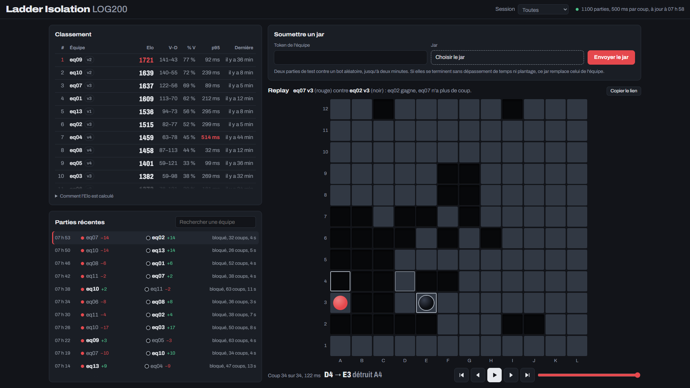
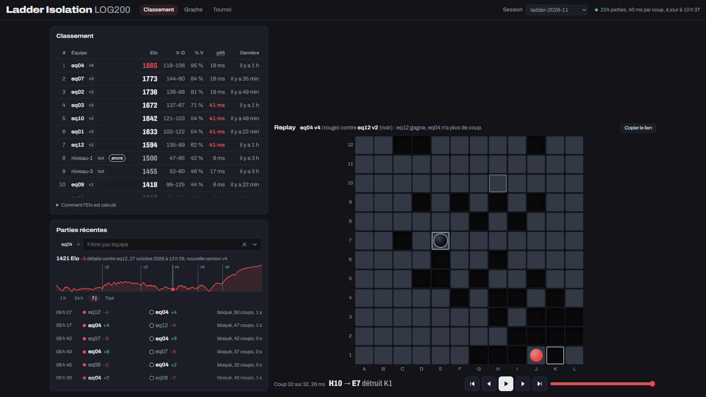
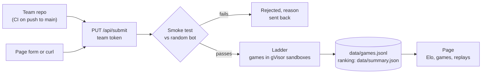

# LOG200-Scoreboard

Live leaderboard (Elo, game history, replays) for the Isolation lab of LOG200.



Search for a team above the recent games to see only its games and, once a single team matches, its Elo over time, over the last hour, day, week or all games. The address follows the choices (`?team=eq08`, `?window=24h`, `?game=<id>`), so a filtered view or a single game can be shared as a link ("Copier le lien" above the replay).



Each team submits its jar; the ladder makes the teams play each other around the clock and the page shows the result:



## Test your bot

No official server and nothing to compile: download the archive for your system from the [latest release](https://github.com/VianAtETS/LOG200-Scoreboard/releases/latest) and extract it. Then, in three terminals and in this order:

```sh
./isolation-referee --port 8888 --time-ms 5000
java -jar Client-eqXX.jar                       # connects first: plays red
./isolation-bot --port 8888 --strategy niveau-1 # plays black
```

The strategies `aleatoire`, `niveau-1`, `niveau-2` and `niveau-3` play like the CPU levels of the official server (Aléatoire, Niveau 1 to 3).

The referee checks every move and prints the result at the end (`winner`, and `reason`: `no_moves`, `timeout`, `disconnect` or `no_show`). An illegal move is answered with `4`, like on the official server. To play black, start the bot before your jar. On Windows, run `.\isolation-referee.exe` and `.\isolation-bot.exe`. On macOS, first run `xattr -d com.apple.quarantine isolation-*` so the unsigned binaries can start.

## Deploy the leaderboard

`docker compose up -d` with the files of the release's `isolation-scoreboard-deploy.zip`: see [`deploy/README.md`](deploy/README.md) (in French).

## Getting started

1. Optional, for conformance checks: copy the official game server from the course (`BoardGame.exe` and its DLLs and folders) into `official-server/`. It is never committed (the folder is git-ignored). Without it, everything else still works.
2. Open the folder in VS Code and choose Reopen in Container. Docker Compose starts two containers:
   - `dev`: Rust, JDK 25, Node 24, and Docker with gVisor for the player sandboxes. VS Code attaches to this one.
   - `server`: the official game server under Wine, shown in a VS Code tab (noVNC on port 6080) and listening on `localhost:8888`, if `official-server/` contains it.

## Components

| Path | Role |
| --- | --- |
| `src/rules.rs` | Game rules as applied by the official server (see `docs/rules.md`) |
| `isolation-referee` | Headless referee for one game; speaks the official protocol, prints one JSON result |
| `isolation-bot` | Protocol client used for tests and conformance checks; its strategies `aleatoire` and `niveau-1` to `niveau-3` replicate the official server's CPU levels (`src/cpu.rs`) |
| `isolation-ladder` | Schedules games between teams, appends to `data/games.jsonl`, publishes the Elo ranking the page reads (`data/summary.json`, `data/teams/`), and receives the teams' jars (`PUT /api/submit`, see `docs/formats.md`) |
| `isolation-check` | Replays and validates a JSONL file or an official save (`BOARDGAME 1`) |
| `sandbox/` | gVisor sandboxes for the referee and each player (see `docs/formats.md`) |
| `web/` | Static page (vanilla JS): Elo ranking, recent games, replay |
| `templates/ladder.yml` | GitHub Actions workflow for the team repositories: builds the jar and submits it on every push to `main` |

The referee contract and the JSONL format are described in `docs/formats.md`. Any referee that follows it, such as the official C++ CLI, can replace ours.

## Build from source

Only the bot uses full LTO and one codegen unit, giving the compiler more optimization opportunities. Other tools use normal release settings to avoid extra build time. The bot is built in `target/bot/`, the other binaries in `target/release/`.

```sh
cargo build --release --bin isolation-referee --bin isolation-ladder --bin isolation-check
cargo build --profile bot --bin isolation-bot
sandbox/build.sh                     # sandbox image (needs Docker with gVisor)
cp ladder.example.toml ladder.toml   # teams, time per move, session
target/release/isolation-ladder ladder.toml
npx http-server . -p 8000            # then open http://localhost:8000/web/
```

Optional for local-only builds: `export RUSTFLAGS="-C target-cpu=native"` before building, then `unset RUSTFLAGS` afterward. Do not distribute these CPU-specific binaries or images.

Tests: `cargo test` and `node --test web/*.test.mjs`.

## Conformance against the official server

Start a game in the server GUI (noVNC, port 6080) with one socket player and one CPU player, then connect our bot as the socket player:

```sh
target/bot/isolation-bot --port 8888 --strategy random --probe-illegal
```

The bot checks every move of the official CPU with our engine. Each turn it first sends a move our engine considers illegal and expects `4` back. A `DIVERGENCE` line in its report means our rules differ from the server's.

Against a CPU set to Niveau 1, with a generous timer, add `--expect niveau-1`: after each game, the bot checks that every CPU move is one our replica could have played.
