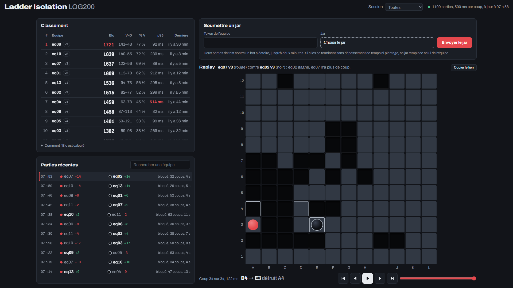
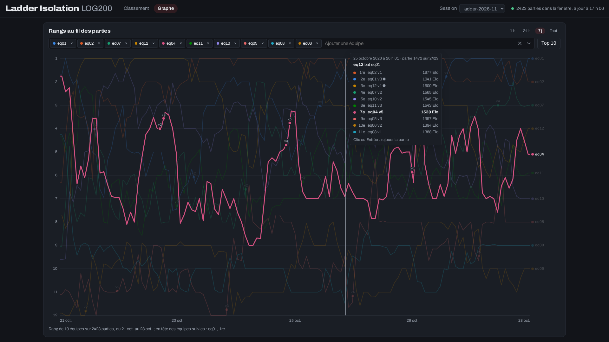
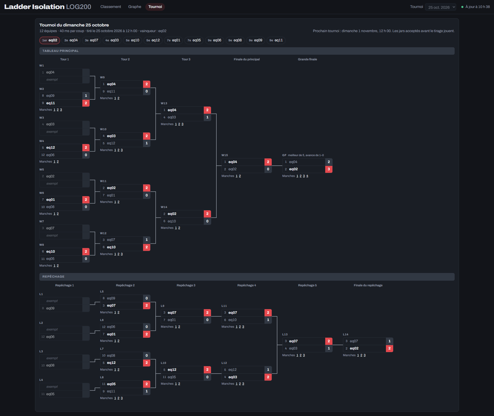
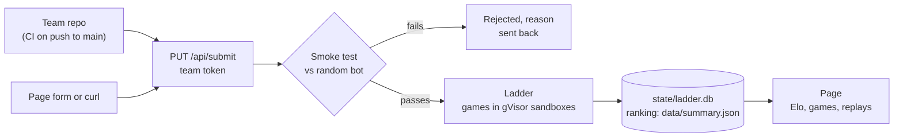

# LOG200-Scoreboard

Live leaderboard (Elo, game history, replays) for the Isolation lab of LOG200.



Pick one or more teams above the recent games (type to filter, × to remove) to see only their games. With several teams, choose between games involving any of them ("Avec l'une") or only their head-to-head games ("Entre elles"). With one team, choose whether to keep it on the left or right, regardless of its color. A link opens the selected teams' charts. The address keeps the filters and selected game, so the view can be shared ("Copier le lien" above the replay).

Ranking headers sort rows in either direction; separate controls choose current/peak Elo, the all-version/current-build record and the move-time statistic. The rank column keeps the official current-Elo position. On phones, scroll the table horizontally to reach every column. A team playing now shows a sword and an antenna after its badges: hovering it (tapping on phones) shows the opponent, the colors and the model's win chance, and highlights the opponent's row; clicking it (the "Suivre en direct" button on phones) follows the game live. On wide screens, drag the line between the ranking and the recent games to share the height; double-click it to reset. Clicking either section title collapses that section and gives the other the room. "Soumettre un JAR" opens the submission form when needed. On phones, the pages and the session selector are in the menu (☰).

The charts page offers rank and Elo views for the same selected teams, session and time window. It shows the top 10 by default; add teams from the field above the chart and remove them with their ×. A node marks each new jar version. Hover, drag a finger or use the arrow keys to read a point; the replay link or Enter opens its game. Explicit team selections and filters follow navigation between the ranking and charts, the default top 10 does not filter the ranking's recent games.




The Analyse page ("Analyser" above the replay, or `analyse.html?game=<id>`; the latest game without `?game=`) replays a game move by move with each color's mobility (squares reachable in one move), territory (squares reached before the opponent) and region (squares still reachable), their curves and the time per move. It marks the critical moves, the 8 largest territory swings of the teams (▲ gained, ▼ cost), and the tipping point ⚑ after which the loser never regains the territory lead. ← → step through the moves, ↑ ↓ jump between critical moves, and clicking a curve or a move shows that position. For the ladder's bots, it also charts the depth reached and the nodes per second of each move, which they publish on stderr with isola's `ARENA` line. These tools are ported from the isola arena by Justin Pagès ([gitlab.com/justin-pages/isola](https://gitlab.com/justin-pages/isola), `arena/web`).

The Duel page ("Duel" on the head-to-head line of the Classement once two teams are picked, or `duel.html?teams=<a>,<b>`) judges two teams on their complete ladder pairs, the two games of a pair sharing their opening with colors swapped (`GET /api/stats/pairs`, see [docs/api.md](docs/api.md)). It compares the current build of each team by default, or any build or all versions. It runs isola's sequential test (SPRT) on the pairs won 2-0, which needs about 78 of them for a verdict, and shows the sign test, each side's score with its 95% Wilson interval and the Elo gap, then every pair with links to its two games on the Analyse page. These statistics are ported from the same isola arena (`arena/web/app.js`).

The leaderboard and chart screenshots use the golden demo data.

The Tournoi page rehearses the final tournament every week. Every Wednesday at 7 a.m. and Sunday at 7 p.m. (Montréal time), the ladder draws the teams that have an accepted jar, freezes their jars and plays a double-elimination bracket before its regular games: strongest against weakest in the first round by verified Elo, best of 3 at 5 s per move, and a best-of-5 grand final where the winners' bracket champion starts 1–0. The page draws the bracket live, Challonge style, with the final standings and a link to replay every game; past tournaments stay available from the selector (`?tournament=`). Between tournaments, the page shows a preview of the next bracket: the draw as it would be right now, updated after every game. Tournament games count only in their own session (`tournoi-2026-11-08`), not in the overall Elo.



Each team submits its jar; the ladder makes the teams play each other around the clock and the page shows the result:



## Test your bot

No official server and nothing to compile: download the archive for your system from the [latest release](https://github.com/VianAtETS/LOG200-Scoreboard/releases/latest) and extract it. Then, in three terminals and in this order:

```sh
./isolation-referee --port 8888 --time-ms 5000
java -jar Client-eqXX.jar                       # connects first: plays red
./isolation-bot --port 8888 --strategy niveau-1 # plays black
```

The strategies `aleatoire`, `niveau-1`, `niveau-2` and `niveau-3` play like the CPU levels of the official server (Aléatoire, Niveau 1 to 3). `niveau-4` and `niveau-5` are not replicas but our own engines, far stronger than Niveau 3. `niveau-5`, the top target of the ladder, evaluates the squares each pawn reaches in one and two moves, keeps searching during the opponent's turn (`--no-ponder` turns this off, for instance when both players share a core), and searches on several cores with `--threads N`.

The referee checks every move and prints the result at the end (`winner`, and `reason`: `no_moves`, `timeout`, `disconnect` or `no_show`). An illegal move is answered with `4`, like on the official server. To play black, start the bot before your jar. On Windows, run `.\isolation-referee.exe` and `.\isolation-bot.exe`. On macOS, first run `xattr -d com.apple.quarantine isolation-*` so the unsigned binaries can start.

## Play remotely

A team can play on the ladder without uploading its jar: the jar runs on its own machine, and `isolation-remote` (in the same archive) relays its moves to the ladder over HTTPS. Run it with the team token and the command that starts the jar:

```sh
LADDER_TOKEN=<token> ./isolation-remote --url https://<ladder> -- java -jar Client-eqXX.jar
```

The relay starts the jar for every game and keeps reconnecting until stopped. The jar connects to `localhost:8888` as usual. Network latency counts against its time per move, and the page marks these games "distant": the server checks neither the code nor the hardware. See "Jouer à distance" in `docs/formats.md`.

## Deploy the leaderboard

`docker compose up -d` with the files of the release's `isolation-scoreboard-deploy.zip`: see [`deploy/README.md`](deploy/README.md) (in French).

## Getting started

1. Optional, for conformance checks: copy the official game server from the course (`BoardGame.exe` and its DLLs and folders) into `official-server/`. It is never committed (the folder is git-ignored). Without it, everything else still works.
2. Open the folder in VS Code and choose Reopen in Container. Docker Compose starts two containers:
   - `dev`: Rust, JDK 25, Node 26.13.1, Bun 1.4.5, and Docker with gVisor for the player sandboxes. VS Code attaches to this one.
   - `server`: the official game server under Wine, shown in a VS Code tab (noVNC on port 6080) and listening on `localhost:8888`, if `official-server/` contains it.

## Components

| Path | Role |
| --- | --- |
| `crates/isolation-core` | Board, game rules as applied by the official server (see `docs/rules.md`), protocol and record formats |
| `isolation-referee` | Headless referee for one game; speaks the official protocol, prints one JSON result (plus one line per move for the ladder's live view when its output is not a terminal) |
| `isolation-bot` | Protocol client used for tests and conformance checks; its strategies `aleatoire` and `niveau-1` to `niveau-3` replicate the official server's CPU levels (`crates/isolation-engine/src/cpu.rs`); `niveau-4` and `niveau-5` are our own stronger engines (`crates/isolation-engine/src/engine.rs`) |
| `isolation-ladder` | Schedules games between teams, records them in SQLite (`state/ladder.db`, served back by `/api/games` and `/api/stats`, see `docs/api.md`), publishes the Elo ranking the pages read (`data/summary.json`, `data/teams/`, `data/timeline.jsonl`), receives the teams' jars (`PUT /api/submit`, see `docs/formats.md`), streams the games in progress (`/api/live`, `[live]` in `ladder.toml`) and runs the weekly tournament (`[tournament]` in `ladder.toml`, `data/tournaments/`, see `docs/spec-tournoi-hebdo.md`) |
| `isolation-check` | Replays and validates a JSONL file or an official save (`BOARDGAME 1`) |
| `isolation-remote` | Relay for a team that plays from its own machine: starts the jar for each game and forwards its lines to the ladder (`/api/remote`, see `docs/formats.md`) |
| `isolation-ladder node` | Compute node: another LAN machine that joins the ladder (`/api/node`, `[nodes]` in `ladder.toml`, `node.example.toml`) and plays its portable pairs with the same referee and sandbox; those games count like any other (see "Nœuds" in `docs/formats.md`) |

| `sandbox/` | gVisor sandboxes for the referee and each player (see `docs/formats.md`) |
| `web/` | Static pages (Astro + React, built to `web/dist`): Elo ranking, recent games, replay; rank and Elo charts of the chosen teams (`graphe.html`); weekly tournament bracket (`tournoi.html`); games in progress, move by move (`direct.html`) |
| `templates/ladder.yml` | GitHub Actions workflow for the team repositories: builds the jar and submits it on every push to `main` |

The referee contract and the JSONL format are described in `docs/formats.md`. Any referee that follows it, such as the official C++ CLI, can replace ours.

## Build from source

Only the bot uses full LTO and one codegen unit, giving the compiler more optimization opportunities. Other tools use normal release settings to avoid extra build time. The bot is built in `target/bot/`, the other binaries in `target/release/`.

```sh
cargo build --release --bin isolation-referee --bin isolation-ladder --bin isolation-check
cargo build --profile bot --bin isolation-bot
sandbox/build.sh                     # sandbox images (needs Docker with gVisor)
cp ladder.example.toml ladder.toml   # teams, time per move, session
target/release/isolation-ladder ladder.toml
target/release/isolation-ladder tournament start ladder.toml  # from another terminal: a tournament right away
bunx http-server . -p 8000            # serves data/ to the page
(cd web && bun install --frozen-lockfile && SCOREBOARD_DEV_SERVER=http://localhost:8000 bun run dev)  # then open http://localhost:3000
```

Optional for local-only builds: `export RUSTFLAGS="-C target-cpu=native"` before building, then `unset RUSTFLAGS` afterward. Do not distribute these CPU-specific binaries or images.

Tests and frontend checks: `cargo test --workspace` and `(cd web && bun run suite)` (see [`docs/frontend-workflow.md`](docs/frontend-workflow.md)).

`(cd web && bun run dev:golden)` shows the page on the ladder's golden test data, with a fake live stream, a small tournament and a queue (`web/dev/golden-server.mjs`): no ladder or Docker needed.

For phone access on a trusted local network, run `(cd web && bun run dev:golden -- --host 0.0.0.0)` on the host, then open `http://<computer-LAN-IP>:3000` on the same network. From a dev container, port 3000 must also be published or forwarded on the host's LAN interface. This is a fixture demo, not the public ladder: do not enter real team tokens or expose it to the Internet.

Styles use only the design tokens in `web/src/styles/tokens.css`: a 4 px spacing grid, type, radius and motion scales, and the light and dark palettes, whose text and control colors meet WCAG AA contrast. Change a value there rather than in `style.css`.

To adjust the layout, the **Layout** button in Astro's dev toolbar outlines every element, one color per nesting depth (`web/dev/layout-debug.css`). Outlines do not shift the layout, and the choice persists across pages for the browser tab. It exists only in `astro dev`.

The page proxies `/api` and `/data` to `SCOREBOARD_DEV_SERVER` in dev (`bun run dev`, default `http://localhost:8080`, the compose stack). `bun run build` writes the static site to `web/dist`; the Pages workflow and `deploy/web.Dockerfile` build it the same way (preceded by `bun run typecheck`).

## Conformance against the official server

Start a game in the server GUI (noVNC, port 6080) with one socket player and one CPU player, then connect our bot as the socket player:

```sh
target/bot/isolation-bot --port 8888 --strategy random --probe-illegal
```

The bot checks every move of the official CPU with our engine. Each turn it first sends a move our engine considers illegal and expects `4` back. A `DIVERGENCE` line in its report means our rules differ from the server's.

Against a CPU set to Niveau 1, with a generous timer, add `--expect niveau-1`: after each game, the bot checks that every CPU move is one our replica could have played.

## Versions archivées du classement (facultatif)

`isolation-ladder ladder.toml --archives` active le filtre de versions archivées sur
le classement. Sans cet argument, l'affichage habituel est conservé. Redémarrer avec
ou sans ce flag ; aucune modification de base n'est nécessaire.
Les graphes gardent leur comportement habituel.

Le filtre permet de rechercher une équipe/version/hash et de cocher précisément les
anciennes versions à afficher, par exemple **eq110 v1** et **eq118 v2**. Plusieurs
anciennes versions d'une même équipe sont sélectionnables. Les choix du classement
sont conservés dans `?archives=` ; « Tout masquer » les retire.

Une version est identifiée par **équipe + hash du JAR**. Son numéro vN garde l'ordre de
`summary.builds` ; une équipe entière n'est jamais déclarée archivée. Le dernier build
joué par l'équipe (toutes sessions) est actif ; si un ancien hash rejoue, il redevient
actif sans changer de numéro. Seuls les builds ayant déjà joué apparaissent.

Les lignes archivées montrent leurs propres victoires/défaites, leur dernier Elo et
leur maximum historique et leurs temps par coup, sans rang actuel ni badge de partie en
cours, à la place de leur Elo dans le classement. Elles ne recalculent pas le classement.
Les sessions, tournois et parties distantes suivent les mêmes filtres que la vue active.
Les historiques des seules équipes archivées sélectionnées sont lus à la demande.
