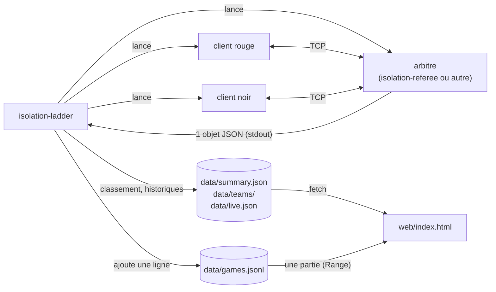
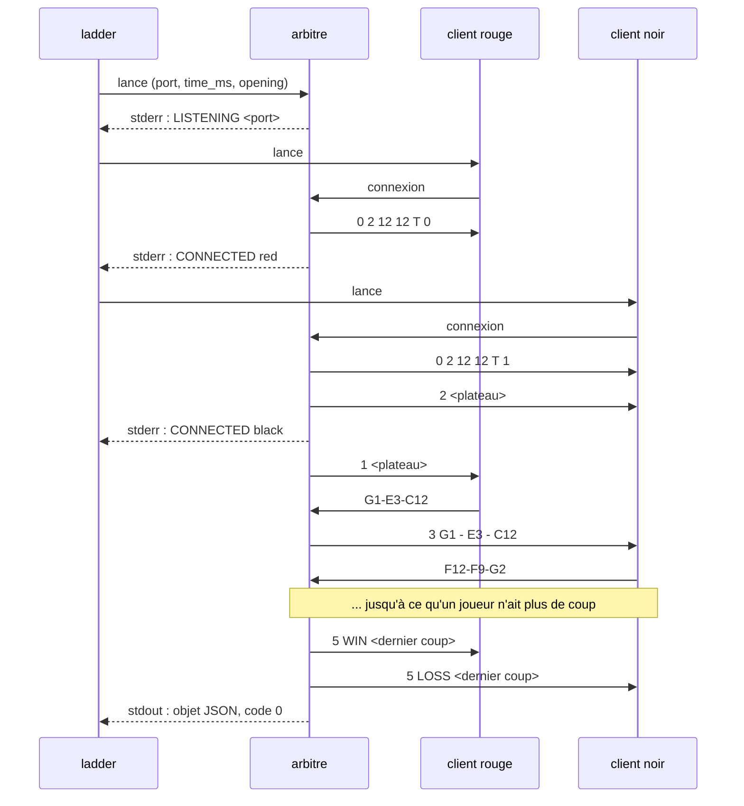
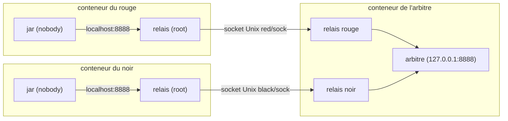
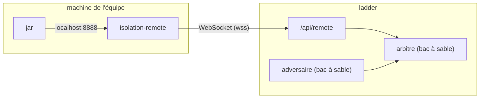

# Ladder Isolation : contrat de l'arbitre et format des parties

Le ladder dépend de deux interfaces. La première permet de remplacer notre arbitre (`isolation-referee`) par une autre implémentation, par exemple la CLI C++ du serveur officiel. La seconde est le fichier des parties, dont le ladder tire aussi ce que lit la page web. Les deux sont en version 1.



## Contrat de l'arbitre

### Ligne de commande

Le ladder lance l'arbitre à partir d'un gabarit configurable (`referee` dans `ladder.toml`) où `{port}`, `{time_ms}` et `{opening}` sont remplacés. Les noms d'options sont libres, seul le comportement compte.

| Paramètre | Sens |
| --- | --- |
| `port` | Port TCP d'écoute. Les parties d'un même slot (voir "Isolation des joueurs") se jouent l'une après l'autre sur ce port. Tous les slots gardent le même : les jars du lab visent 8888 en dur, et le bac à sable donne à chaque partie son propre réseau. |
| `time_ms` | Temps par coup, annoncé aux clients et appliqué (500 ms au ladder, 5000 ms au tournoi). |
| `opening` | Optionnel. Demi-coups imposés avant de donner la main aux clients, séparés par des virgules (`G1-G4-F9,F12-F10-G7`). Toujours en nombre pair, pour que le rouge joue le premier coup client. |

### Déroulement

1. L'arbitre écoute sur le port et écrit `LISTENING <port>` sur sa sortie d'erreur.
2. La première connexion est le rouge, la seconde le noir. Après chacune, il écrit `CONNECTED red` puis `CONNECTED black` sur sa sortie d'erreur. Le ladder attend `CONNECTED red` avant de lancer le noir : sans ça, une JVM qui démarre plus lentement inverserait les couleurs.
3. Il applique le protocole du serveur officiel (voir plus bas).
4. À la fin, il écrit un seul objet JSON, sur une ligne, sur sa sortie standard, et sort avec le code 0 quel que soit le gagnant. Un joueur qui ne se connecte pas dans le délai perd la partie (`no_show`) sans qu'aucun coup soit joué ; si c'est le rouge, le ladder ne lance pas le noir.



Si une autre implémentation n'écrit pas `LISTENING` ni `CONNECTED red`, il suffit de laisser les marqueurs vides dans `ladder.toml` : le ladder attend alors `startup_ms` à la place.

### Objet résultat

Écrit sur une seule ligne (présenté ici sur plusieurs) :

```json
{
  "v": 1,
  "time_ms": 500,
  "opening": ["G1-H2-I12", "F12-F11-E2"],
  "moves": ["G1-F2-C12", "F12-E11-C5"],
  "winner": "black",
  "reason": "no_moves",
  "invalid": { "red": 0, "black": 2 },
  "duration_ms": 15100,
  "move_ms": [212, 480]
}
```

| Champ | Type | Sens |
| --- | --- | --- |
| `v` | entier | Version du format : 1. |
| `time_ms` | entier | Temps par coup appliqué. |
| `opening` | liste | Demi-coups imposés (peut être vide). |
| `moves` | liste | Coups des clients au format `G1-E3-C12` (départ, arrivée, case détruite). |
| `winner` | `"red"` ou `"black"` | Il n'y a pas de nulle en Isolation. |
| `reason` | chaîne | `no_moves` : le perdant n'avait plus de coup. `timeout` : temps dépassé. `disconnect` : connexion perdue. `protocol` : trop de coups invalides, si une limite est fixée. `no_show` : le perdant ne s'est jamais connecté (jar qui plante au démarrage, conteneur tué). |
| `invalid` | objet | Nombre de coups refusés (`4`) par couleur. |
| `duration_ms` | entier | Durée de la partie. |
| `move_ms` | liste (facultatif) | Temps de chaque coup de `moves`, même index, de la demande de coup au coup accepté (coups refusés compris). Absent ou de longueur différente de `moves` : ignoré. |

Avant d'enregistrer un résultat, le ladder rejoue la partie avec notre moteur ; un coup illégal ou un gagnant incohérent la fait rejeter.

## Fichier des parties (`data/games.jsonl`)

Une ligne JSON par partie terminée, en ajout seul. Chaque ligne reprend l'objet résultat avec les champs ajoutés par le ladder :

```json
{
  "id": "20261024T142103.512Z-eq07-eq12",
  "session": "ladder-2026-11",
  "ts": "2026-10-24T14:21:03.512Z",
  "red": { "team": "eq07", "build": "3fa9c2d1e0b4a7f6" },
  "black": { "team": "eq12" },
  "v": 1,
  "time_ms": 500,
  "opening": ["G1-H2-I12", "F12-F11-E2"],
  "moves": ["G1-F2-C12", "F12-E11-C5"],
  "winner": "red",
  "reason": "no_moves",
  "invalid": { "red": 0, "black": 0 },
  "duration_ms": 15100,
  "move_ms": [212, 480]
}
```

- `build` : les 16 premiers caractères hexadécimaux du sha256 du jar. Un nouveau hash correspond à une nouvelle soumission : le rating est conservé mais repasse en K provisoire.
- `anchor` (absent par défaut) : joueur de référence dont le rating reste à 1500. Sans ancre, le classement est relatif entre les équipes.
- `remote` (absent par défaut) : l'équipe a joué depuis sa propre machine. Le serveur n'a pas vu son code, et `build` est celui qu'elle déclare.
- `tournament` (absent par défaut) : `{"id": "tournoi-2026-11-08", "match": "W3", "game": 2}`, partie d'un tournoi hebdomadaire (voir [spec-tournoi-hebdo.md](spec-tournoi-hebdo.md)) : id du tournoi, match du tableau et numéro de la manche.
- Chaque ligne part en une seule écriture suivie d'un flush. Un lecteur peut donc tomber sur une dernière ligne incomplète ; la page et `isolation-check` l'ignorent, comme les versions inconnues.

## Fichiers de la page (`data/summary.json`, `data/teams/`, `data/timeline.jsonl`, `data/live.json`)

La page ne lit jamais `games.jsonl` en entier : en fin de session, il pèse des centaines de Mo. Le ladder calcule le classement Elo et les temps par coup, et publie à côté de `games.jsonl` :

- `summary.json`, réécrit après chaque partie (fichier temporaire puis renommage) :
  - `sessions` : la plus récente d'abord ;
  - `builds` : builds de chaque équipe dans l'ordre d'apparition, pour le badge vN ;
  - `scopes` : `""` pour toutes les sessions, puis une clé par session. Chacune donne `games` (nombre), `time_ms` (temps alloués), `ratings` (classement, meilleur d'abord) et `recent` (50 dernières parties).
  - `verified` : mêmes clés et même forme que `scopes`, mais sans les parties où un côté est `remote` : l'Elo y est recalculé sur les seules parties jouées sur le serveur. Absent tant qu'aucune partie distante n'a été jouée ; la page n'affiche sa case "Vérifiées seulement" qu'à partir de là.
- `teams/<équipe>.jsonl` : une ligne par partie de l'équipe, en ajout seul comme `games.jsonl`. La page le suit quand la recherche désigne une seule équipe : courbe Elo et liste de ses parties.
- `timeline.jsonl` : une ligne par partie, toutes équipes, en ajout seul. Elle ne garde que `v`, `id`, `ts`, `session`, `red` et `black` d'une ligne de partie : assez pour rejouer les ratings de toutes les équipes, ce que fait la page graphe pour calculer les rangs.
- `live.json`, réécrit au lancement et à la fin de chaque partie (fichier temporaire puis renommage) : `{"v": 1, "games": [{"red": "eq07", "black": "eq12", "since": "2026-10-24T14:20:48.103Z"}]}`, une entrée par partie en cours, la plus ancienne d'abord. `since` compte l'attente d'un slot, qu'un smoke test peut occuper. Le ladder le vide au démarrage.

Une ligne de partie (dans `recent` et `teams/`) reprend la partie sans les coups :

```json
{
  "v": 1, "id": "20261024T142103.512Z-eq07-eq12", "ts": "2026-10-24T14:21:03.512Z",
  "session": "ladder-2026-11", "time_ms": 500, "winner": "red", "reason": "no_moves",
  "moves": 48, "duration_ms": 15100,
  "red": { "team": "eq07", "build": "3fa9c2d1e0b4a7f6", "all": [1520.0, 20.0], "session": [1520.0, 20.0] },
  "black": { "team": "eq12", "all": [1480.0, -20.0], "session": [1480.0, -20.0] },
  "at": [0, 912]
}
```

- `all` et `session` : rating après la partie et variation, toutes sessions confondues puis dans la session de la partie.
- `remote` (absent par défaut) : comme dans `games.jsonl`.
- `verified` (absent par défaut) : `{"all": [...], "session": [...]}`, les ratings du classement sans parties distantes, seulement s'ils diffèrent de `all` et `session`. Absent d'une partie vérifiée, ils leur sont égaux ; une partie distante n'en a jamais, et la page l'écarte quand la case est cochée.
- `at` : position et longueur de la ligne complète dans `games.jsonl`. Le replay la lit avec `Range: bytes=<début>-<fin>`.
- Une ligne de `ratings` : `team`, `rating`, `games`, `wins`, `losses`, `build_games` et `build_wins` (parties et victoires du build courant, base du % V), `anchor`, `provisional`, `remote` (le build courant a joué au moins une partie à distance : badge "distant"), `build`, `last` (dernière partie), et `pace` (absent sans temps mesurés) : `mean` (moyenne arrondie), `p50`, `p95`, `p99`, `max` et `count` des temps par coup du build courant, `limit` le plus petit temps alloué.
- Au démarrage, le ladder réécrit `teams/`, `timeline.jsonl` et `summary.json` à partir de `games.jsonl`. Une équipe dont le nom n'est pas fait de lettres, chiffres, `-` et `_` (64 au plus) n'a pas de fichier d'équipe.

## Protocole des clients

Le serveur envoie une commande par ligne :

| Message | Sens |
| --- | --- |
| `0 2 12 12 T C` | Nouvelle partie : version 2, lignes, colonnes, temps par coup (ms), couleur (0 rouge, 1 noir). |
| `2 <144 entiers>` | Envoyé au noir dès sa connexion : plateau initial. |
| `1 <144 entiers>` | Envoyé au rouge : plateau initial, et première demande de coup. |
| `3 G1 - E3 - C12` | Demande de coup, avec le dernier coup adverse. |
| `4` | Coup refusé. Le chrono continue, il faut renvoyer un coup. |
| `5 WIN\|LOSS <coup>` | Fin de partie, avec le coup final. |
| `5 TIMEOUT` | Fin sur dépassement de temps, envoyé aux deux joueurs. |

Valeurs du plateau : 0 vide, 1 détruite, 3 pion noir, 5 pion rouge, la ligne 12 d'abord, colonnes A à L. Le client répond un coup par ligne, au format `G1-E3-C12`, `G1 E3 C12` ou `G1E3C12`.

## Isolation des joueurs

Le ladder exécute le code des équipes. Chaque partie tourne donc dans des conteneurs jetables sous gVisor (`runsc`), comme dans les correcteurs automatiques CTester et PALS. Les scripts sont dans `sandbox/`, les limites dans la section `[sandbox]` de `ladder.toml`.



Ce que ça garantit, vérifié avec des jars hostiles :

- Pas de réseau : ni Internet ni DNS.
- Un jar n'atteint que la socket de sa couleur, et chaque relais n'accepte qu'une connexion. Il ne peut donc pas en ouvrir une seconde pour jouer à la place de l'adversaire. Sous gVisor, deux conteneurs ne partagent pas de loopback, d'où les sockets Unix.
- Le jar tourne en `nobody`, sans capacités, sur un système de fichiers en lecture seule (sauf un `/tmp` de 64 Mo). Il ne voit ni le jar ni la socket de l'adversaire, et ne peut pas tuer son relais.
- Les jars tournent dans une image sans nos binaires (`isolation-sandbox-jar`), et `/tmp` est `noexec`. Un jar ne peut donc lancer ni `isolation-bot --strategy niveau-4` à sa place, ni un binaire natif qu'il embarquerait.
- Mémoire, processus et CPU sont plafonnés, avec un cœur dédié par couleur. Un dépassement de mémoire tue le conteneur du joueur, pas la machine. Les threads Java ne comptent pas dans le plafond de processus.
- Plusieurs parties peuvent se jouer en même temps, une par `[[slot]]` de `ladder.toml`. Chaque slot remplace les clés de `[sandbox]` qu'il redéfinit, en pratique `cpuset_red` et `cpuset_black` : deux parties ne partagent jamais un cœur. Une équipe ne joue qu'une paire à la fois, et une paire n'est lancée que si elle fait partie des moins jouées. Sans `[[slot]]`, une seule partie à la fois. Les smoke tests prennent eux aussi un slot libre.
- Un slot `multithread = true` est réservé aux parties d'une équipe multithread : jar actif déclarant `Ladder-Threads: 2` (voir "Soumission des jars"), ou `multithread = true` dans son `[[team]]`. Son adversaire y joue aussi, pour que les deux couleurs aient les mêmes cœurs : on lui donne en général un cœur physique entier par couleur, par exemple `cpuset_red = "4,5"`, `cpuset_black = "6,7"` et `cpus = "2"`. Les autres parties ne prennent jamais ce slot. Sans slot `multithread`, le drapeau est sans effet ; sans slot ordinaire, tout se joue dans les slots `multithread`. Les smoke tests prennent un slot ordinaire.
- Les conteneurs et les sockets sont supprimés après chaque partie, et au démarrage du ladder après un arrêt brutal.

Le coût : environ 60 ms de plus au démarrage, et 20 à 30 % de calcul en moins sur un test qui alloue beaucoup. C'est pareil pour les deux joueurs, mais un bot va un peu moins loin qu'au tournoi.

Sur la machine du ladder, il faut Docker et gVisor, avec ce runtime dans `/etc/docker/daemon.json` :

```json
{ "runtimes": { "runsc-host-uds": { "path": "/usr/bin/runsc", "runtimeArgs": ["--host-uds=all"] } } }
```

`--host-uds` laisse les bacs à sable se connecter aux sockets Unix des répertoires montés ; seul le répertoire de la partie l'est. `sandbox/build.sh` construit ensuite deux images : `isolation-sandbox` (Java 24, socat et nos binaires), pour l'arbitre et les bots, et `isolation-sandbox-jar` (la même sans nos binaires), pour les jars.

## Soumission des jars

Le ladder reçoit les jars des équipes par HTTP, si `ladder.toml` a une section `[submit]`. Dans le déploiement Docker, la page relaie `/api/` vers ce service.

```
PUT /api/submit
Authorization: Bearer <token de l'équipe>
<le jar, tel quel, dans le corps de la requête>
```

```sh
curl -T Client-eq07.jar -H "Authorization: Bearer $TOKEN" https://<ladder>/api/submit
```

Le formulaire de la page fait la même chose. Le token identifie l'équipe : `isolation-ladder add-team eq07` l'inscrit et affiche son token une seule fois ; seul son sha256 est conservé (`jars/teams.toml`).

À la réception :

1. Le jar est comparé au jar actif de l'équipe. S'il est identique, rien ne se passe. Son manifeste peut déclarer `Ladder-Threads: 1` (par défaut) ou `2` ; toute autre valeur le fait refuser.
2. Une équipe ne peut soumettre qu'une fois par `min_interval_s` (5 minutes par défaut), et le jar ne doit pas dépasser `max_jar_mb`.
3. Smoke test : le jar joue une partie dans chaque couleur, dans le bac à sable, contre le bot aléatoire. Il peut perdre, mais pas par dépassement de temps, déconnexion, absence ou coups invalides. Il attend la fin de la partie en cours du ladder : compter jusqu'à une ou deux minutes.
4. S'il passe, il remplace atomiquement `jars/<équipe>/current.jar` (l'ancien est supprimé) et joue dès la partie suivante. Une équipe inscrite entre au classement avec son premier jar accepté.

Un jar `Ladder-Threads: 2` joue toutes ses parties dans un slot `multithread`, avec 2 cœurs par couleur, adversaire compris. Ces slots étant moins nombreux, ses parties sont moins fréquentes. Le smoke test, lui, se joue sur 1 cœur. La déclaration suit le jar : la version suivante, sans l'attribut, rejoue sur 1 cœur.

| Code | Sens |
| --- | --- |
| 200 | Accepté, ou identique au jar actif. |
| 400 | Le corps n'est pas un jar, ou `Ladder-Threads` ne vaut ni 1 ni 2. |
| 401 | Token absent ou inconnu. |
| 413 | Jar trop gros. |
| 422 | Refusé par le smoke test ; la raison est dans la réponse et le jar actif reste en jeu. |
| 429 | Trop tôt depuis la soumission précédente. |
| 500 | Erreur du ladder pendant le smoke test : réessayer plus tard. |

La réponse est un texte court destiné à l'équipe. Chaque soumission est notée dans `jars/submissions.jsonl`, qui n'est pas publié.

### Depuis la CI

[`templates/ladder.yml`](../templates/ladder.yml) est un workflow GitHub Actions à placer dans `.github/workflows/` du dépôt de chaque équipe (ou dans le template du lab). À chaque push sur `main` qui modifie `src/`, il compile `src/*.java` pour Java 24, construit le jar avec `Client` comme classe principale et le soumet. Le verdict du ladder s'affiche dans le résumé du run, et le run échoue si le jar est refusé.

Réglages du dépôt, dans Settings > Secrets and variables > Actions :

| Nom | Type | Valeur |
| --- | --- | --- |
| `LADDER_URL` | variable | adresse de la page du ladder, par exemple `https://ladder.example.org` |
| `LADDER_TOKEN` | secret | token de l'équipe |

Sans `LADDER_URL`, le job est sauté : le workflow peut donc vivre dans le template avant que le ladder existe. Le jar est reproductible (date des entrées fixée à celle du commit) : relancer un run sur le même commit répond "déjà actif" au lieu de créer une nouvelle version. La machine du ladder doit être joignable depuis les runners GitHub ; sinon, les équipes passent par le formulaire de la page.

Pour essayer le workflow en local avec [act](https://github.com/nektos/act), depuis un dépôt d'équipe et avec le ladder lancé sur la même machine :

```sh
act workflow_dispatch -P ubuntu-latest=catthehacker/ubuntu:act-latest --network host \
  --var LADDER_URL=http://localhost:8080 --secret LADDER_TOKEN=<token>
```

## Jouer à distance

Une équipe peut jouer au ladder sans téléverser son jar : il tourne sur sa machine, et `isolation-remote` (dans l'archive de la release) relaie ses lignes au ladder par une WebSocket. Le ladder garde l'arbitre, l'Elo et la page ; il ne voit jamais le jar.

```sh
LADDER_TOKEN=<token> isolation-remote --url https://<ladder> -- java -jar Client-eq07.jar
```



Pour chaque partie, le relais lance la commande ; le jar se connecte à lui comme au serveur officiel, sans changement. Le même token que pour les soumissions identifie l'équipe ; elle doit être inscrite (`add-team`), sans avoir besoin d'un jar accepté. Tant que le relais est connecté, l'équipe entre au tirage et joue à la place de son jar s'il y en a un ; déconnectée, son jar reprend.

Ce qu'il faut savoir :

- **Rien n'est vérifié.** Le serveur ne voit pas le code, ne limite ni les cœurs ni la mémoire, et le `build` est déclaré par le relais (sha256 du jar lancé, comme sur le serveur : un même jar garde sa version vN). Ces parties portent `remote` (voir `games.jsonl`), la page les marque d'un badge "distant", et sa case "Vérifiées seulement" recalcule l'Elo sans elles.
- **La latence compte dans le temps du jar** : l'arbitre chronomètre au serveur. Le relais mesure l'aller-retour et annonce au jar `T` moins cette marge dans `0 2 12 12 T C` (au moins `T/2`) ; un jar qui ignore `T` n'en profite pas.
- **Une fois apparié, on joue.** Le message de partie ne nomme pas l'adversaire ; un relais déconnecté ou muet perd par `no_show`, un jar qui plante par `disconnect`. Un relais qui ne lance pas son jar est déconnecté à la fin de la partie.

### Protocole (version 1)

`GET /api/remote` avec `Authorization: Bearer <token>`, puis une trame texte JSON par message, `{"type": …}` :

| Sens | Message | Rôle |
| --- | --- | --- |
| relais → ladder | `hello {v, build, client}` | `v` : 1 ; `build` : 16 caractères hexadécimaux |
| ladder → relais | `welcome {team, time_ms}` | session ouverte |
| ladder → relais | `game {id, side, time_ms}` | lancer le jar, qui se connecte au relais |
| relais → ladder | `ready` | jar connecté : le ladder le relie à l'arbitre |
| relais → ladder | `failed {reason}` | jar pas lancé ; la session se ferme |
| les deux | `line {text}` | une ligne du protocole des clients, sans fin de ligne |
| relais → ladder | `hangup` | le jar a fermé sa connexion en cours de partie |
| ladder → relais | `end {id}` | l'arbitre a raccroché : partie finie |

Un token inconnu reçoit `401` avant l'upgrade. Le ladder ferme la session avec une raison (trame de fermeture, code 1008) : `hello` invalide, session remplacée par une nouvelle connexion de l'équipe, partie de l'équipe en cours, nouveau build déclaré moins de `min_interval_s` après le précédent (le délai entre deux soumissions de jar), jar jamais lancé. La raison d'un `failed` est reprise dans les journaux sur une ligne, sans caractères de contrôle et coupée à 200 caractères. Il envoie un ping toutes les 10 s et lâche un relais muet depuis 30 s ; seule une session entendue depuis 15 s entre au tirage. Au-delà de 256 connexions simultanées, poignées de main comprises, les suivantes sont fermées aussitôt.

### Côté serveur

Section `[remote]` de `ladder.toml` (demande `[submit]`, qui tient les tokens) : `listen`, l'adresse de la WebSocket, relayée par la page sur `/api/remote` ; `connect`, où relier le joueur distant : `unix:<rundir>/{game}/{side}/sock`, la socket de sa couleur chez l'arbitre, ou `tcp:127.0.0.1:{port}` pour un arbitre sans bac à sable. Le journal du joueur (`data/logs/`) reçoit le diagnostic du relais : délai avant `ready`, aller-retour médian.

## Mise en route

```sh
cargo build --release --bin isolation-referee --bin isolation-ladder --bin isolation-check
cargo build --profile bot --bin isolation-bot
sandbox/build.sh                            # images des bacs a sable
cp ladder.example.toml ladder.toml          # equipes, temps, session
target/release/isolation-ladder ladder.toml # Ctrl+C pour arreter, relancer reprend la session
target/release/isolation-check data/games.jsonl
npx http-server . -p 8000                   # ou python3 -m http.server 8000
# puis ouvrir http://localhost:8000/web/
```

La page lit le dossier `../data` par défaut (un autre dossier se passe avec `web/?data=URL`) et se rafraîchit toutes les 15 secondes. Les fichiers qu'elle lit sont écrits par le ladder : pour regarder un `games.jsonl` sans lancer de parties, `isolation-ladder ladder.toml --rounds 0` les génère, avec `out` qui pointe vers ce fichier.

Elle lit les fichiers d'équipe et les parties du replay par morceaux (en-tête `Range`). Un serveur qui ignore `Range`, comme `python3 -m http.server`, renvoie le fichier entier : ça fonctionne, mais sans le gain.
