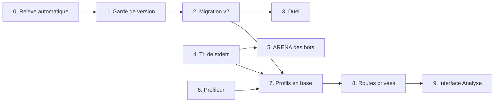

# Spec : duel et profileur, portés de l'arène isola

Statut : validée le 2026-11-18, décrit le commit `bf8872d` (plus la page Analyse, non commitée à cette date). Outils d'origine : l'arène isola de Justin Pagès ([gitlab.com/justin-pages/isola](https://gitlab.com/justin-pages/isola)), `arena/web/app.js` et `arena/src/Profiler.java`.

## Problème

La page Analyse a repris la partie « analyse d'une partie » d'isola. Il manque les deux autres outils :

- **Le verdict entre deux jars.** Le site donne l'Elo et un bilan de face-à-face, mais ne dit pas si un build est vraiment meilleur qu'un autre, ni combien de parties il faudrait pour le savoir.
- **Le profileur.** Une équipe ne voit pas où son jar passe son temps ni à quelle profondeur il cherche, sur le serveur où il joue vraiment.

### Objectifs

- Verdict entre deux builds choisis : paires 2-0, 0-2 et 1-1, test du signe, SPRT, score par partie ± intervalle de Wilson à 95 %, écart Elo.
- Profil d'un jar (temps par fonction, arbre d'appels, profondeur de pile), visible de son équipe seule, avec son jeton.
- Part publique du temps passé dans les méthodes du gabarit du cours, si l'équipe le choisit.
- Profondeur et nœuds par coup des bots de référence, publics.

### Hors périmètre

- Profiler les parties distantes : le jar tourne chez l'équipe, le ladder ne le voit pas.
- Profiler les bots Rust par échantillonnage de pile (ils impriment leurs mesures, voir « Bots de référence »).
- Profiler en tournoi ou sur un nœud de calcul.
- Empêcher un jar de falsifier son propre profil : il partage la JVM du profileur. La part publique est donc présentée comme « déclarée ».

## Ouvertures et paires

Une **ouverture** est le champ `opening` d'une partie : 2 demi-coups tirés au hasard par le ladder pour chaque paire (`pairs.rs`, `opening_plies = 2`) et imposés par l'arbitre avant de donner la main aux jars (voir [formats.md](formats.md)). Le champ `moves` ne contient que les coups des équipes. Le replay met l'ouverture devant les coups : les deux premiers coups de sa liste sont l'ouverture, joués par aucune équipe.

Une **paire** est formée par les deux parties de `spawn_pair` (`play.rs`) : mêmes équipes, même ouverture, couleurs inversées, jouées l'une après l'autre dans le même fil d'exécution. Le ladder ne nomme pas la paire aujourd'hui.

- **Colonne `games.pair`** : le `seq` de la première partie de la paire, écrit pour les deux parties. La règle est déterministe : la migration est idempotente et ne renumérote jamais une paire écrite en direct.
- **En direct** : `spawn_pair` passe le `seq` de la première partie à la seconde.
- **Une seule partie** (arrêt du ladder, partie en erreur jamais enregistrée) : `pair` vaut le `seq` de cette partie, sans partenaire. Les statistiques n'utilisent que les paires complètes.
- **Tournois exclus** : leurs manches réutilisent la même ouverture dans les deux couleurs ; `pair` reste `NULL`.

### Migration v1 → v2

- `PRAGMA user_version` passe de 1 à 2. `ALTER TABLE games ADD COLUMN pair INTEGER`, index sur `pair`.
- **Appariement de l'historique**, une fois : pour chaque partie hors tournoi, sa suivante dans l'ordre des `seq` *parmi les parties des deux mêmes équipes* (le `seq` global est entrelacé par les créneaux parallèles) forme une paire si elle a la même ouverture et les couleurs inversées. Sinon la partie reste seule.
- Les parties importées de `data/games.jsonl` au démarrage passent par la même règle, après l'import.
- Tables `profiles` et `profiling` (plus bas), dans la même migration.
- **Garde de version** : un binaire qui ouvre une base de version supérieure à la sienne s'arrête avec un message clair (`base v2, binaire v1`), au lieu d'écraser `user_version` comme `db.rs` le fait aujourd'hui. Un retour arrière passe par une restauration `.backup`. La garde est **livrée seule, avant la migration** : le binaire actuel ne l'a pas.

## Page Duel

- `duel.html?teams=a,b&builds=h1,h2`, ouverte depuis la ligne de face-à-face du Classement quand deux équipes sont choisies. Un sélecteur de build par équipe, les builds actuels par défaut, et « toutes les versions ».
- `GET /api/stats/pairs?a=&b=&build_a=&build_b=` (public) : les paires complètes entre ces builds, chacune avec ses deux ids de partie, son ouverture et ses vainqueurs, de la plus récente à la plus ancienne.
- **Statistiques**, reprises d'isola et testées contre lui :
  - Paires gagnées 2-0 par chaque côté, paires 1-1 (décidées par l'ouverture).
  - Test du signe bilatéral sur les paires 2-0, en logarithmes (p < 0,05).
  - SPRT sur les paires 2-0 : H0 chaque côté gagne la moitié, H1 65 % ; α = 2,5 % par côté, β = 10 %.
  - Score par partie et son intervalle de Wilson à 95 %.
  - Écart Elo tiré de ce score, pas de la table `ratings`, qui est par équipe et non par build.
- **Verdict lent** : le SPRT demande en moyenne environ 78 paires décisives sous H1 (ln 36 / 0,0457). Sans verdict, la page affiche « indécis : N paires décisives, environ 78 nécessaires » et propose « toutes les versions » en un clic.
- La ligne de face-à-face du Classement affiche le nombre de paires des builds actuels, pour qu'un lien « 14 parties » ne s'ouvre pas sur 0 paire.
- Chaque paire renvoie à ses deux parties sur la page Analyse.

## Profileur

### Activation

- **Opt-in par build, désactivé par défaut.** `PUT /api/profiling` avec le jeton, corps `{"private": bool, "public": bool}`, pour le build courant de l'équipe. Un nouveau build repart désactivé.
- Deux options séparées : `private` profile le jar ; `public` publie la part du gabarit (implique `private`). Aucune équipe ne devient publique sans l'avoir choisi.
- Les parties profilées restent des parties normales du ladder : elles comptent.
- **Marge** : la couleur profilée reçoit +5 % sur son délai par coup (25 ms à 500 ms), dans l'arbitre (option par couleur). `move_ms` n'est jamais corrigé : le jar mesure son propre temps, le coût de l'échantillonnage reste dans sa recherche et le profil l'affiche.
- **Jamais en tournoi ni sur un nœud** : un build profilé n'est pas portable (`roster.rs`), et ses manches de tournoi se jouent sans profileur ni marge.

### Dans le bac à sable

- Variante de `Profiler.java` d'isola, compilée en `profiler.jar` et montée en lecture seule comme `/bot.jar` : l'image du jar reste sans binaire du ladder. `run-player.sh` ajoute `-javaagent:/profiler.jar` quand `SANDBOX_PROFILE=1`.
- **Pas de socket de contrôle** (le bac à sable est `--network none`) : le profileur déduit le tour lui-même. L'agent calcule quand aucun de ses threads n'est bloqué dans une lecture (socket, console) ; rien n'est compté avant la première lecture (démarrage de la JVM). Une lecture de moins de 10 ms peut passer inaperçue : deux tours forment alors un seul segment, quand l'adversaire répond aussi vite. Toutes les 10 ms pendant le calcul, il lit les piles des threads de plateforme qui exécutent du code de l'agent ; les threads virtuels ne sont pas échantillonnés.
- **Une ligne par segment de calcul** sur stderr, et une pour le dernier à la sortie de la JVM, au format d'isola (`prof n=… t=… rec=… cost=… end=1 Classe.méthode=self:total … @chemin=n …`) ; `t` compte les tics passés à calculer, `cost` le temps passé à échantillonner (µs). Pas de vidage toutes les 250 ms.
- **Contrôle de cohérence** : à la fin de la partie, le ladder compare le temps échantillonné (somme des `t`) au temps de réflexion du jar (somme de ses `move_ms`). Sous 50 % (thread lecteur dédié, threads virtuels), le profil est marqué « détection douteuse ». Le nombre de segments ne sert pas : les tours fusionnés le rendent inférieur aux coups sans que le profil soit faux.

### Canal et stockage

- Le lecteur de stderr du ladder (`exec.rs`) met de côté les lignes qui commencent par `prof ` ou `ARENA `, avec leur propre plafond. Le reste du journal ne change pas : `data/logs/`, 1 Mio, 60 jours, invisible du public.
- En fin de partie, ces lignes sont analysées et écrites dans la même transaction que la partie : table `profiles (game, color, team, build, turns, moves, overhead_ms, tree, arena, template)` ; `turns` compte les segments ; la détection est douteuse quand le temps échantillonné est sous la moitié du temps de réflexion (D25), marqué dans `tree`.
- Les nœuds renvoient déjà le stderr des joueurs (`FromNode::Result`) : rien à ajouter, mais un build profilé n'y joue pas.

## Bots de référence

- `isolation-bot` imprime sur stderr, après chaque coup, la ligne d'isola `ARENA depth=<profondeur terminée> nodes=<nœuds>`.
- Les lignes `ARENA` d'un bot sont publiques (son code l'est) : elles vont dans un champ `measures` du record de la partie, servi par `GET /api/games/{id}`. La page Analyse montre profondeur et nœuds par seconde du bot.
- Un jar d'équipe peut imprimer la même ligne sur **stderr** (le ladder jette stdout, contrairement à isola) : elle reste privée, dans son profil.

## Accès

| Donnée | Où | Qui la voit | Effacement |
|---|---|---|---|
| Profil d'un jar (arbre, profondeur, ARENA de l'équipe) | `profiles` | L'équipe : `GET /api/games/{id}/profile`, jeton | `DELETE /api/profiles`, jeton |
| Part du gabarit | `profiles.template`, si `public` | Tous : `GET /api/stats/template-share?team=&build=` | Avec le profil |
| ARENA des bots | `measures` du record | Tous : `GET /api/games/{id}` | Jamais (code public) |
| Reste de stderr | `data/logs/` | Personne | 60 jours, inchangé |

- `GET /api/games/{id}/profile` ne renvoie que le côté de l'appelant. Même 404 si l'équipe n'a pas joué la partie ou n'a pas de profil : la route ne révèle pas l'existence d'un profil.
- **Gabarit** : liste versionnée des `Classe.méthode` du code de départ du cours (`Client`, `GameConnection` et ses classes `Message` et `GameInfo`), tenue par l'opérateur dans `crates/isolation-ladder/src/template.txt`. Une pile ne porte pas les types des paramètres : la correspondance se fait sur la classe et le nom, les surcharges sont fusionnées. La part publique donne le pourcentage d'échantillons par méthode du gabarit et un total « autres » ; ni arbre ni profondeur, qui trahiraient la force de la recherche.
- **Page Analyse** : une section Profil demande le jeton, gardé en `sessionStorage` (même clé que le formulaire de soumission), et affiche l'arbre d'appels d'isola, la profondeur et le coût de l'échantillonnage, ou « détection douteuse ».

## Sécurité

- **Jeton** : comparaison existante (`submit/auth.rs`, sha256 en temps constant). Jetons aléatoires de 24 octets : pas de limite de débit propre à ces routes.
- **Cache** : `GET /api/games/{id}/profile` répond `Cache-Control: private, no-store` et `Vary: Authorization`, 404 compris. `GET /api/games/{id}` reste public et immuable : ne pas réutiliser son assistant de réponse.
- **CORS** : ajouter `DELETE` au préflight de Caddy (aujourd'hui `GET, PUT`).
- **XSS** : le jeton en `sessionStorage` est lisible par un script injecté ; React échappe tout, le site n'affiche aucun HTML d'utilisateur.
- **Rétention, risque accepté** : les profils privés ne sont supprimés qu'à la demande de l'équipe (`DELETE /api/profiles`). Il n'y a pas de purge de fin de session : le profil d'une équipe qui ne le supprime pas reste dans la base du ladder après le cours.
- **Marge, risque accepté** : un jar peut détecter `-javaagent` et consommer les 25 ms de marge. Borné au ladder, qui sert d'entraînement ; les tournois, qui comptent, sont sans profileur ni marge.
- **Licence** : isola n'a pas de licence. Justin Pagès a donné son accord écrit (message du 2026-11-18) pour ajouter ses outils au ladder, `Profiler.java` compris.

## Vérification et versions

- **Tests en conteneur**, en local comme pour le serveur : `rust:1.99.1` (la version de `rust-toolchain.toml`) pour `cargo`, `node:24` pour le site. Le profileur se teste dans l'image du bac à sable (`isolation-sandbox-jar`).
- **Version automatique**, comme [pals](https://github.com/Vianpyro/pals) : après une CI verte sur `main`, `.github/release.sh` relève la version du workspace selon les messages Conventional Commits depuis le dernier tag, avec la règle actuelle du dépôt (`feat` → mineure, `fix` et `perf` → correctif, changement cassant → mineure avant 1.0), commite `chore(release): vX.Y.Z`, pose le tag et lance `release.yml` par `workflow_dispatch` (un tag poussé avec `GITHUB_TOKEN` ne déclenche aucun workflow). Le contrôle manuel de version des pull requests (`version_bump.py`) disparaît.
- `tests/release/check.sh` vérifie la règle de relève sur un dépôt jetable, en essai à blanc (`DRY_RUN=1`).

## Cas limites

- Paire dont la seconde partie est rejouée après un délai de nœud : même ouverture, même paire ; seule la partie enregistrée compte.
- Deux paires des mêmes équipes avec la même ouverture : l'ordre des `seq` parmi leurs parties les sépare.
- Build resoumis au milieu d'une paire : le jar est figé pour la paire, les deux parties ont le même build.
- Jar qui lit la socket dans un thread dédié : profil marqué « détection douteuse », non rejeté.
- Jar qui écrit beaucoup sur stderr : le plafond du journal ne touche pas les lignes `prof` et `ARENA`.
- Équipe qui désactive `public` : la part n'est plus servie ; les profils déjà écrits gardent leur part jusqu'à leur suppression.

## Tests

- **Statistiques** (`node --test`) : test du signe, SPRT, Wilson et Elo comparés aux valeurs d'`app.js` d'isola.
- **Migration** (Rust) : base v1 d'essai avec créneaux entrelacés, une manche de tournoi, une paire d'une partie, deux paires de même ouverture ; une seconde exécution ne change rien ; une base v3 est refusée.
- **Route privée** : sans jeton 401, autre équipe 404, bonne équipe son côté seulement, en-têtes de cache.
- **Profileur** : faux client Java qui lit dans le thread principal (tours = coups), puis dans un thread dédié (« détection douteuse ») ; analyse des lignes `prof` et `ARENA`.
- **Relève de version** : `tests/release/check.sh`, cas repris de pals, avec la règle du dépôt.

## Decisions Log

| ID | Topic | Decision | Rationale | Source | Date |
|---|---|---|---|---|---|
| D1 | Source des paires | Colonne `pair` écrite par le ladder, et reconstruction de l'historique | Exact à l'avenir, historique compris | Interview | 2026-11-18 |
| D2 | Deux calculs | Reconstruction faite une fois, en migration ; un seul chemin de lecture | Deux calculs vivants finiraient par diverger | Interview | 2026-11-18 |
| D3 | Builds comparés | Un build choisi par côté, builds actuels par défaut | Le verdict doit parler de jars précis | Interview | 2026-11-18 |
| D4 | Emplacement | Page `duel.html`, ouverte depuis la ligne de face-à-face | Place pour les sélecteurs, le verdict et les paires | Interview | 2026-11-18 |
| D5 | Quand profiler | Opt-in par build, désactivé par défaut ; banque de temps envisagée | Le jar mesure son propre temps : une compensation invisible est impossible | Interview | 2026-11-18 |
| D6 | Signal du tour | Déduit dans le profileur : aucun thread bloqué en lecture de socket | Aucun canal à ajouter au bac à sable sans réseau | Interview | 2026-11-18 |
| D7 | Accès privé | `GET /api/games/{id}/profile`, jeton, côté de l'appelant, même 404 | Ne rien révéler aux autres équipes | Interview | 2026-11-18 |
| D8 | Jeton | `sessionStorage`, clé partagée avec le formulaire de soumission | Confort pendant la visite, rien après la fermeture de l'onglet | Interview | 2026-11-18 |
| D9 | Noms du gabarit | Part publique : pourcentage par `Classe.méthode` du gabarit et « autres », sans arbre ni profondeur | Les noms du gabarit sont connus de tous, la profondeur révèle la force | Interview | 2026-11-18 |
| D10 | Consentement | Deux options séparées, désactivées par défaut | Aucune publication involontaire | Interview | 2026-11-18 |
| D11 | Bots Rust | Ligne `ARENA` par coup, publique ; `ARENA` des jars privée | Le code des bots est déjà public | Interview | 2026-11-18 |
| D12 | Marge | +5 %, jamais en tournoi ni sur un nœud ; build profilé non portable | Ce sont les tournois qui comptent ; exploit borné accepté contre l'avis du red team | Red Team | 2026-11-18 |
| D13 | Canal et stockage | Lignes `prof` et `ARENA` mises de côté de stderr, en base en fin de partie, une ligne par tour ; part publique « déclarée » | Plafond de 1 Mio, rétention de 60 jours, falsification possible par le jar | Red Team | 2026-11-18 |
| D14 | Règles de migration | Consécutives parmi les parties des deux équipes, hors tournoi, idempotente, `pair` = `seq` de la première partie | `seq` entrelacé, ouvertures de tournoi réutilisées | Red Team | 2026-11-18 |
| D15 | Retour arrière | Refus d'une base de version supérieure ; garde livrée avant la migration | `db.rs` écrase `user_version` sans le vérifier | Red Team | 2026-11-18 |
| D16 | Verdict lent | « indécis : N sur environ 78 », bascule vers toutes les versions, nombre de paires sur le Classement | Le SPRT conclut rarement entre builds actuels | Red Team | 2026-11-18 |
| D17 | Rétention | Suppression à la demande seulement, sans purge de fin de session | Choix de l'utilisateur ; risque accepté et documenté | Red Team | 2026-11-18 |
| D18 | Détection douteuse | Tours détectés comparés aux coups, profil marqué s'ils diffèrent | Thread lecteur dédié, threads virtuels | Red Team | 2026-11-18 |
| D19 | Cache | `private, no-store`, `Vary: Authorization`, 404 compris | Route voisine d'une route immuable, derrière un CDN possible | Red Team | 2026-11-18 |
| D20 | Écart Elo | Tiré du score des paires des builds choisis | `ratings` est par équipe, pas par build | Red Team | 2026-11-18 |
| D21 | Format ARENA, licence | `ARENA` lu sur stderr seulement ; accord écrit de Justin Pagès | Le ladder jette stdout ; isola n'a pas de licence | Red Team | 2026-11-18 |
| D22 | Tests | En conteneur : `rust:1.99.1`, `node:24`, image du bac à sable | Demande de l'utilisateur ; même environnement que le serveur | Interview | 2026-11-18 |
| D23 | Versions | Relève automatique après CI verte sur `main`, comme pals ; `version_bump.py` retiré | Plus de relève à la main dans les pull requests | Interview | 2026-11-18 |
| D24 | Segments de calcul | Une ligne par segment et une à la sortie, au lieu d'une par tour | Une lecture de moins de 10 ms échappe à l'échantillonnage : deux tours fusionnent contre un adversaire rapide | Implémentation | 2026-11-18 |
| D25 | Détection douteuse | Temps échantillonné sous 50 % du temps de réflexion du jar, au lieu de tours ≠ coups | Robuste aux tours fusionnés ; un thread lecteur dédié reste à 0 % | Implémentation | 2026-11-18 |
| D26 | Gabarit | `Client` et `GameConnection` (avec `Message`, `GameInfo`), sans `Board` ni `Square` ; part gardée en échantillons, le pourcentage calculé à la lecture | Le code de départ ne contient que ces deux fichiers ; des comptes se somment sur plusieurs parties | Implémentation | 2026-11-20 |

## Dependency Graph & Implementation Order

0. **Relève automatique** : `.github/release.sh`, `version.yml`, `tests/release/check.sh`, retrait de `version_bump.py`.
1. **Garde de version** : refus d'une base plus récente ; livrée et déployée seule.
2. **Migration v2** : colonne `pair` et index, appariement de l'historique, écriture en direct dans `spawn_pair` ; tables `profiles` et `profiling`.
3. **Duel** : `GET /api/stats/pairs`, statistiques web testées contre isola, `duel.html`, nombre de paires sur le Classement.
4. **Tri de stderr** : lignes `prof` et `ARENA` mises de côté avec leur plafond, analysées en fin de partie.
5. **ARENA des bots** : `isolation-bot` imprime profondeur et nœuds par coup ; champ `measures` ; affichage sur la page Analyse.
6. **Profileur** : variante de `Profiler.java`, montage dans `run-player.sh`, `PUT /api/profiling`, marge par couleur dans l'arbitre, build profilé non portable.
7. **Profils en base** : écriture avec la partie, contrôle du temps échantillonné, part du gabarit si publiée.
8. **Routes privées** : `GET` du profil, `DELETE /api/profiles`, en-têtes de cache, `DELETE` dans le préflight de Caddy, `GET /api/stats/template-share`.
9. **Interface Analyse** : section Profil (jeton en `sessionStorage`), réglages d'opt-in, part publique.
