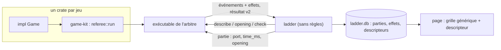

# Spec : plateforme multi-jeux

Statut : brouillon du 2026-11-16, en cours d'implémentation sur `refactor/plateforme-multi-jeux` (étapes 1 à 3 faites).

## Problème

La plateforme a été construite autour d'Isolation : le ladder rejoue les parties avec les règles d'Isolation, la page rejoue les coups `G1-E3-C12` en sachant ce qu'ils font, et les formats supposent un gagnant rouge ou noir. Or le jeu du lab change à chaque session : pour servir au cours, Isolation doit devenir un jeu parmi d'autres, et les parties des sessions passées doivent rester consultables.

### Objectifs

- Ajouter un jeu sans toucher au ladder, à la base ni à la page : implémenter un trait Rust suffit.
- Faire tourner plusieurs jeux en même temps (une instance du ladder par compétition).
- Garder l'historique lisible pour toujours, même si le code d'un jeu change ou disparaît.
- Isolation continue de fonctionner à l'identique pendant toute la migration (tests golden inchangés).
- Valider l'approche avec un second jeu : Hnefatafl.

### Hors périmètre

- Chargement dynamique de code (dylib, WASM) : un jeu change une fois par session, une release suffit.
- Un seul processus du ladder pour plusieurs jeux : une instance par compétition est plus simple et isole les pannes.
- Jouer contre un bot dans la page (demanderait les règles côté client, en WASM).

## Principes

1. **Une partie enregistrée est un fait, pas un calcul.** Chaque coup enregistré porte ses effets sur le plateau. Le replay applique ces effets : il n'exécute aucune règle, et une correction de règle ne change pas les parties passées.
2. **Le ladder ne connaît aucune règle.** Il ne parle qu'au contrat de l'arbitre ; les coups sont pour lui des chaînes opaques. Ce que le ladder a besoin de savoir d'un jeu, l'arbitre le lui dit (`describe`, `opening`, `check`).
3. **Un jeu, c'est un arbitre.** Le crate `game-kit` fournit le trait `Game` et le cadre de l'arbitre ; un jeu implémente le trait et son `main` tient en une ligne. N'importe quel programme qui respecte le contrat reste accepté (la CLI du serveur officiel, par exemple).
4. **La grille générique est le plancher.** La page dessine n'importe quel jeu sur grille à partir du descripteur et des effets. Un jeu peut fournir son propre rendu, mais jamais indispensable : sans lui, la grille s'affiche.

## Architecture



## Le trait `Game` (`crates/game-kit`)

| Élément | Rôle |
| --- | --- |
| `State`, `Move` | Position et coup. `Move` s'écrit et se lit en notation canonique (`Display`, `FromStr`). |
| `descriptor()` | Identité, taille, position initiale, légende des cases (voir plus bas). |
| `initial()`, `cells(state)` | Position de départ ; codes des cases, dans l'ordre des messages `1` et `2` du protocole. |
| `is_legal`, `legal_moves` | Légalité d'un coup du joueur au trait ; tous ses coups (bot aléatoire, ouvertures). |
| `apply(state, side, mv)` | Joue le coup et rend ses effets (`Change`). |
| `ending(state, mover)` | Après un coup de `mover` : fin de partie, avec gagnant et raison. |
| `protocol_move(mv)` | Format des messages `3` et `5` du serveur officiel. |
| `random_opening(plies, rng)` | Ouverture aléatoire ; par défaut, des coups légaux tirés au hasard. |

Les joueurs alternent, le premier (`red`) commence. `game-kit` en tire, pour chaque jeu, l'arbitre (`referee::run`), le rejeu (`Replay<G>`) et la validation d'un résultat.

## Camps

`red` et `black` restent, dans tous les formats, les identifiants du premier et du second joueur : la position de connexion, pas une couleur. Le nom affiché vient du descripteur (« Rouge » et « Noir » en Isolation, « Attaquants » et « Défenseurs » en Hnefatafl). Garder ces identifiants évite de migrer les enregistrements, l'API et la page.

## Contrat de l'arbitre, version 2

La partie elle-même ne change pas (gabarit `referee`, `{port}`, `{time_ms}`, `{opening}`, marqueurs, protocole). S'y ajoutent trois sous-commandes, que le ladder lance avec le même exécutable, sans bac à sable (elles ne parlent à aucun joueur) :

| Commande | Sortie |
| --- | --- |
| `describe` | Le descripteur du jeu, en JSON sur une ligne. |
| `opening --plies N --seed S` | Une ouverture aléatoire reproductible, au format de `--opening`. |
| `check` | Lit des résultats (un JSON par ligne) sur l'entrée standard ; écrit pour chacun `{"ok":true,"changes":[...]}` ou `{"ok":false,"error":"..."}`. Sert à valider les parties des nœuds et à remplir les effets des parties enregistrées avant la v2. |

### Effets

Chaque événement `move` porte les effets du coup, à appliquer dans l'ordre :

```json
{"event":"move","move":"G1-E3-C12","ms":212,"changes":[{"cell":138,"code":0,"role":"from"},{"cell":110,"code":5,"role":"to"},{"cell":2,"code":1,"role":"effect"}]}
```

`cell` est l'index dans le plateau du protocole, `code` la nouvelle valeur de la case, `role` sert à marquer le dernier coup : `from` (départ), `to` (arrivée), `effect` (case détruite, pièce capturée...).

### Résultat v2

Le résultat v1 plus :

| Champ | Sens |
| --- | --- |
| `v` | 2. |
| `game`, `game_version` | Identité du jeu, comme dans le descripteur. |
| `winner` | `"red"`, `"black"`, ou `null` pour une nulle. |
| `reason` | Une fin selon les règles : `no_moves` ou une raison propre au jeu, déclarée dans `reasons` du descripteur. Ou un abandon, commun à tous les jeux (`timeout`, `disconnect`, `protocol`, `no_show`), qui a toujours un gagnant. |

Le ladder lit encore les résultats v1 (anciens arbitres, parties déjà enregistrées). Les effets ne sont pas dans le résultat : `check`, qui valide la partie, les rend, et le ladder les range à part (voir Base), pour que les listes de parties de l'API restent légères.

## Descripteur

```json
{
  "game": "isolation",
  "version": 1,
  "name": "Isolation",
  "rows": 12,
  "cols": 12,
  "sides": { "red": { "label": "Rouge" }, "black": { "label": "Noir" } },
  "initial": [0, 0, 0, 0, 0, 3, "...", 5, "..."],
  "pieces": [
    { "code": 0, "label": "vide", "style": "empty" },
    { "code": 1, "label": "case détruite", "style": "hole" },
    { "code": 3, "label": "pion noir", "style": "pawn", "side": "black" },
    { "code": 5, "label": "pion rouge", "style": "pawn", "side": "red" }
  ],
  "special": [],
  "reasons": { "no_moves": "plus aucun coup" }
}
```

`special` liste les cases particulières (trône et coins en Hnefatafl : `{"cell":60,"style":"throne"}`). `style` est un nom que la page traduit en dessin ; un style inconnu est dessiné comme une pièce générique de son camp. Le ladder enregistre le descripteur une fois par `(game, version)` et ne le modifie jamais : changer les règles ou l'affichage d'un jeu, c'est monter sa version.

## Base

- `games.changes` (schéma v3) : les effets de chaque demi-coup (JSON), rendus par `check`. Les parties enregistrées sans, dont tout l'historique d'une base v2, sont rejouées par lots au démarrage ; une partie refusée est signalée et retentée au démarrage suivant. `GET /api/games/{id}` les ajoute à la partie.
- `descriptors` : `(game, version, descriptor)`, écrit au démarrage s'il est nouveau, jamais remplacé.
- L'identité du jeu est dans chaque résultat v2 (`game`, `game_version`) ; une partie v1 est une partie du jeu de l'instance.
- Nulles : `winner` vaut `draw` dans la colonne (qui reste `NOT NULL`), `null` dans le résultat ; l'Elo et le modèle de prédiction comptent 0,5, les statistiques ni victoire ni défaite. En tournoi, une manche nulle est rejouée (nouvelle ouverture, couleurs inversées) ; à la troisième, la meilleure tête de série l'emporte.

## Instances

Une instance du ladder par compétition (un jeu, une session) : son `ladder.toml`, sa base, son `data/`. Caddy sert chaque instance sous son préfixe (`/isolation/`, `/hnefatafl/`) et une page d'accueil liste les instances. Les cœurs sont partagés en donnant des `cpuset` disjoints aux slots de chaque instance. Une session terminée reste en ligne en lecture seule.

## Page

- `data/game.json` : le descripteur de l'instance. Titres, noms des camps et légende en viennent.
- Plateau générique : `rows × cols`, cases dessinées d'après `pieces` et `special`, dernier coup marqué d'après `role`. Positions = `initial` + effets, sans aucune règle.
- Rendus propres : un composant par jeu dans `web/src/games/<id>/`, enregistré au build, qui reçoit position, effets et descripteur. Une erreur ou une absence retombe sur la grille.

## Étapes

Chaque étape est une PR qui garde Isolation identique (tests golden).

1. `game-kit` : trait, descripteur, effets, cadre de l'arbitre ; Isolation l'implémente, `isolation-referee` devient `referee::run(Isolation)` et gagne `describe`, `opening` et `check`.
2. Ladder sans règles : coups opaques, ouverture et validation par l'arbitre (`rules` dans `ladder.toml`), plus de rejeu dans le hub. Le ladder ne dépend plus d'`isolation-core`.
3. Format v2 et base : effets, descripteurs, nulles (Elo, modèle, tournoi).
4. Page : descripteur, plateau générique, effets dans l'API et le direct.
5. Instances multiples : configuration, déploiement, page d'accueil.
6. Hnefatafl : règles, arbitre, bot aléatoire.

## Questions ouvertes

- Variante d'Hnefatafl de la session précédente (taille, capture du roi, répétitions, limite de coups) et son encodage dans le protocole officiel.
- Nulle dans un match de tournoi au meilleur de N : rejouée, ou comptée pour moitié ?
- Renommage des crates `isolation-*` (le mot désigne aussi le bac à sable) : en fin de migration, dans une PR à part.
