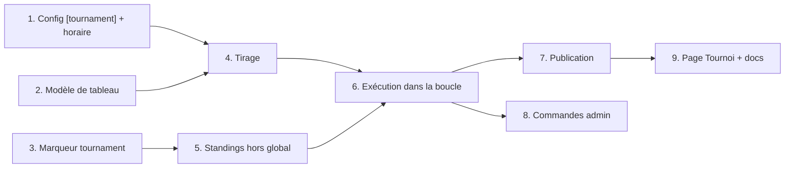

# Spec : tournoi hebdomadaire

Statut : validée le 2026-10-31, décrit le commit `f3ca389`. Aperçu visuel : https://claude.ai/artifact/55s79zSjnQS2YTQgT6rucL (privé).

## Problème

Le tournoi final du lab compte pour 4 points sur 15, et les équipes ne découvrent son format que le jour même. Chaque dimanche à midi, le ladder joue une répétition de ce tournoi : même format, même temps par coup. Les parties restent consultables après coup.

Format annoncé par l'enseignant : double élimination, avec un premier tour fort contre faible selon l'Elo, pour envoyer les équipes faibles au repêchage dès le début.

### Objectifs

- Reproduire le format du final : double élimination, têtes de série par Elo, 5 s par coup.
- Lancer le tournoi sans intervention chaque semaine, ou à la main pour un test.
- Garder le ladder actif pendant les 3 à 5 h du tournoi.
- Montrer le tableau en direct, puis le garder consultable avec les replays.

### Hors périmètre

- Bots niveau-N au tableau (aucun, même pour compléter la grille).
- Équipes distantes au tableau.
- Matrice de face-à-face, paris, prédictions.
- Endpoint HTTP d'administration.

## Format du tableau

- **Double élimination.** Tableau principal, repêchage, grande finale.
- **Têtes de série** : Elo vérifié (sans parties distantes) de la session ladder en cours (`cfg.session`), au moment du tirage. Sans partie vérifiée dans la session : 1500. Égalité : ordre d'arrivée dans la session, comme le classement.
- **Premier tour** : seeding classique (1 contre N, 2 contre N-1…, placés pour que 1 et 2 ne se croisent qu'en finale).
- **Effectif** : complété à la puissance de 2 supérieure par des exemptions (byes), données aux meilleures têtes de série. Moins de 4 équipes : tournoi sauté et journalisé.
- **Repêchage** : les perdants du principal descendent en croisé (perdant de W5 vers L4, de W6 vers L3 à 8 équipes) pour éviter une revanche immédiate.
- **Grande finale** : vainqueur du principal contre vainqueur du repêchage, au meilleur de 5. Le vainqueur du principal part à 1–0. Pas de remise à zéro.
- **Classement final** : 1er et 2e par la grande finale, puis par tour d'élimination au repêchage (3e, 4e, 5e–6e, 7e–8e…).

## Format d'un match

- **Meilleur de 3.** Manches 1 et 2 : couleurs inversées. Belle à 1–1 : couleur tirée au sort.
- **Ouvertures** : 2 demi-coups aléatoires, comme au ladder (`opening_plies`). Les manches 1 et 2 partagent l'ouverture A ; la belle part d'une ouverture B. Raison : les jars étudiants sont presque tous déterministes, et depuis le plateau initial la belle recopierait une manche.
- **Grande finale** : premier à 3 ; ouvertures A, A, B, B, C.
- **Temps par coup** : `[tournament] time_ms`, 5000 par défaut. Le ladder garde son `time_ms`.
- **Défaites normales** : `no_moves`, `timeout`, `disconnect`, `protocol`, `no_show` comptent comme au final.

## Participants

- Toute équipe inscrite avec un jar actif au tirage (`submit::active_teams`). Ni les `[[team]]` de la config (bots), ni les sessions distantes.
- **Jar figé** : le tirage copie `jars/<équipe>/current.jar` vers `jars/tournaments/<id>/<équipe>.jar` et note son build. Une soumission pendant le tournoi ne vaut que pour le ladder.
- Un jar `Ladder-Threads: 2` joue ses matchs dans un slot `multithread`, comme au ladder.
- `jars/tournaments/<id>/` est supprimé à la fin du tournoi.

## Déclenchement

```toml
[tournament]
weekly = "sun 12:00"   # heure de Montréal (America/Toronto)
time_ms = 5000
min_teams = 4
catch_up_h = 2
retries = 3
```

- Sans section `[tournament]`, aucun tournoi automatique ; la commande manuelle reste possible.
- **Fuseau** : `jiff` 0.2 avec la feature `tzdb-bundle-always`. L'image finale `docker:…-dind-alpine` n'a pas de base de fuseaux. Prochain créneau : `Zoned::now().in_tz("America/Toronto")`, puis aujourd'hui si c'est dimanche et avant midi, sinon `nth_weekday(1, Weekday::Sunday)`, puis `with().time(12:00).build()`. Midi reste midi après le changement d'heure.
- **Rattrapage** : au démarrage, un créneau passé depuis moins de `catch_up_h` heures, sans tournoi de cet id, part tout de suite. Au-delà : sauté et journalisé.
- **Chevauchement** : un tournoi encore en cours fait sauter le suivant (journalisé).
- **Id** : `tournoi-AAAA-MM-JJ` (date de Montréal), suffixe `-2`, `-3` pour un second le même jour.

### Commandes admin

```sh
docker compose exec ladder isolation-ladder tournament start  ladder.toml
docker compose exec ladder isolation-ladder tournament resume ladder.toml tournoi-2026-11-08 W3
```

- La commande dépose un fichier de requête dans `jars/admin/` (non publié). La boucle le lit et le supprime à chaque tour : au plus `IDLE_DELAY` (10 s) d'attente.
- `resume` ne débloque qu'un match `suspendu` ; l'id de match est validé contre le tableau.

## Cohabitation avec le ladder

- À chaque tour de la boucle de `main.rs`, les matchs prêts du tournoi prennent les slots libres avant `Scheduler::next_pair`.
- Même ensemble `busy` : une équipe ne joue qu'une partie à la fois, tous modes confondus. Un match prêt dont une équipe est en paire ladder attend la fin de la paire, sans réserver de slot.
- Les parties du tournoi n'entrent pas dans le `Scheduler` : `Scheduler::from_history` ne relit que `cfg.session`, et le tournoi n'appelle pas `scheduler.record`.

## Données

### Parties

Dans `games.jsonl`, sous leur propre session, avec un champ facultatif `tournament` :

```json
{ "id": "…-eq07-eq12", "session": "tournoi-2026-11-08", "time_ms": 5000, "…": "…",
  "tournament": { "id": "tournoi-2026-11-08", "match": "W3", "game": 2 } }
```

- La session du tournoi a son propre Elo à 5 s, visible dans le sélecteur de session existant.
- **Hors Elo global** : `Standings` ignore les parties `tournament` dans la portée « Toutes sessions » (`ALL`), dans sa version vérifiée et dans `rating()` (matchmaking). Leurs lignes portent `all = [rating inchangé, 0]`.
- `isolation-check` et la vérification par le moteur s'appliquent comme aux autres parties.

### État du tournoi

- `data/tournaments/<id>.json`, réécrit après chaque partie (fichier temporaire puis renommage) : têtes de série, Elo au tirage, builds figés, graine des ouvertures, matchs (id, tableau, tour, places, score, ids des parties, statut `attente` | `en cours` | `fini` | `suspendu`), classement final.
- `data/tournaments/index.json` : la liste des tournois, le plus récent d'abord, et l'heure du prochain créneau.
- `live.json` : champ facultatif `tournament` (id et match) par partie en cours.
- Les ouvertures se déduisent de la graine et de (match, paire de manches) : une reprise rejoue la même ouverture.

## Page Tournoi

- `web/tournoi.html`, 3e onglet après Classement et Graphe.
- Visuel inspiré de Challonge, aux couleurs du ladder :
  - une bande par tableau (principal, repêchage), puis la grande finale ;
  - une carte à deux lignes par match : tête de série, équipe, version vN au survol, score dans une case à droite, rouge pour le gagnant ;
  - des lignes de liaison simples, sans flèches.
- Match en cours : même signal que les parties en cours de la page Classement. Match suspendu : marqué en rouge.
- Sélecteur des tournois passés, suivi dans `?tournament=` (l'adresse se partage, convention des autres pages).
- Clic sur une manche : replay par `index.html?game=<id>`.
- Avant le tirage : l'heure du prochain tournoi, pour savoir jusqu'à quand soumettre.
- Page Classement : la courbe « Toutes sessions » ignore les parties `tournament` (delta 0) pour ne pas tracer de paliers plats.

## Pannes et reprise

- **Partie annulée** (`GameError` de l'arène : arbitre, Docker, partie rejetée par la vérification) : relancée avec la même ouverture, jusqu'à `retries` fois. Ensuite le match passe `suspendu`, le journal et la page le signalent, les autres matchs continuent, et `tournament resume` le débloque.
- **Redémarrage du ladder** : le tournoi en cours se reconstruit depuis `data/tournaments/<id>.json` et les parties `tournament` de `games.jsonl`. La partie interrompue est rejouée.
- **Jar figé disparu** (disque) : partie annulée, donc même traitement.

## Sécurité

- Aucune nouvelle surface réseau : l'administration passe par un fichier local, donc par un accès shell au serveur.
- Les jars figés restent sous `jars/`, que Caddy ne sert pas, et sont effacés à la fin du tournoi.
- Les ids de tournoi viennent de la date ; le seul champ libre d'une requête (id de match) est validé contre le tableau avant usage.
- Les jars jouent dans le même bac à sable gVisor que le ladder.

## Cas limites

- Équipe dont le jar actif disparaît entre deux tours : son jar figé joue quand même.
- Les deux équipes d'un match prêt en paire ladder : le match attend les deux.
- Tournoi lancé à la main un samedi : le dimanche midi en lance un autre (ids différents).
- Effectif impair ou non puissance de 2 : byes, jamais de match contre un bot.
- `summary.json` pendant le tournoi : la session du tournoi devient la plus récente, la page Classement s'ouvre dessus par défaut jusqu'à la reprise du ladder.

## Tests

- Modèle de tableau (pur, sans Docker) : seeding à 4, 5, 8, 13 et 16 équipes, byes, descente croisée, belle, finale à 1–0 terminée en 3 ou 4 parties, classement final.
- Horaire : prochain créneau un dimanche avant et après midi, en semaine, autour des deux changements d'heure ; rattrapage dans et hors de `catch_up_h`.
- Reprise : historique partiel (une manche jouée, un match suspendu) reconstruit le même tableau et la même ouverture.
- `Standings` : une partie `tournament` laisse la portée `ALL` et `rating()` inchangées, et compte dans sa session.
- E2E (`tests/e2e.rs`) : tournoi à 4 bots-jars sur `time_ms` court, terminé avec un vainqueur.

## Decisions Log

| ID | Topic | Decision | Rationale | Source | Date |
|---|---|---|---|---|---|
| D1 | Format | Double élimination, tour 1 fort contre faible | Format annoncé par l'enseignant pour le final | Interview | 2026-10-31 |
| D2 | Têtes de série | Elo vérifié de la session ladder en cours, 1500 sans partie | L'Elo distant est gonflé (cœurs, mémoire non limités) | Interview | 2026-10-31 |
| D3 | Match | Meilleur de 3, couleurs inversées, belle couleur tirée | Toujours décisif, durée bornée | Interview | 2026-10-31 |
| D4 | Ouvertures | Une ouverture pour les manches 1-2, une nouvelle pour la belle | Les jars déterministes recopieraient une manche | Interview | 2026-10-31 |
| D5 | Bots | Aucun bot niveau-N ; places vides = byes | Le tableau ne compte que les équipes | Interview | 2026-10-31 |
| D6 | Temps | `time_ms` propre au tournoi, 5000 par défaut | Fidélité au final, réglable | Interview | 2026-10-31 |
| D7 | Déclenchement | Dimanche 12 h (heure de Montréal) plus commande manuelle | Rythme connu des équipes, tests hors calendrier | Interview | 2026-10-31 |
| D8 | Ladder | Priorité au tournoi, ladder dans les slots libres | Les derniers tours laissent des slots vides | Interview | 2026-10-31 |
| D9 | Jar | Figé au tirage | Comme un jar remis au final ; pas de changement selon l'adversaire | Interview | 2026-10-31 |
| D10 | Inscrits | Jar accepté seulement, distants exclus | Rien à figer pour un distant, code non vérifié | Interview | 2026-10-31 |
| D11 | Grande finale | Meilleur de 5, vainqueur du principal à 1–0, sans remise à zéro | Garde l'avantage du principal, 4 parties au plus | Interview | 2026-10-31 |
| D12 | Données | Session propre dans `games.jsonl`, hors Elo global et matchmaking | Elo 5 s par tournoi, replays et sélecteur existants, sans fausser le ladder | Interview | 2026-10-31 |
| D13 | Page | Page Tournoi dédiée | Arbre lisible, tournois passés consultables | Interview | 2026-10-31 |
| D14 | Annulations | 3 essais, puis match suspendu | Personne ne perd à cause du serveur | Interview | 2026-10-31 |
| D15 | Admin | Fichier de commande local | Aucune surface réseau nouvelle | Interview | 2026-10-31 |
| D16 | Horaire manqué | Rattrapé si moins de 2 h de retard | Évite un tournoi surprise à une heure inattendue | Interview | 2026-10-31 |
| D17 | Défauts | Byes aux meilleures têtes, repêchage croisé, minimum 4 équipes, slots multithread | Proposés en fin d'entretien, sans objection | Interview | 2026-10-31 |
| D18 | Rétention | Jars figés supprimés à la fin du tournoi | Les replays n'en ont pas besoin ; validé avec l'aperçu | Interview | 2026-10-31 |
| D19 | Fuseau | `jiff` 0.2, feature `tzdb-bundle-always` | Midi reste midi après le changement d'heure ; l'image alpine n'a pas de base de fuseaux | Interview | 2026-10-31 |
| D20 | Visuel | Tableau façon Challonge, couleurs du ladder | Référence fournie, lisible pour les étudiants | Interview | 2026-10-31 |

## Dependency Graph & Implementation Order



1. **Config `[tournament]` et horaire** : clés, validation (`deny_unknown_fields`), prochain créneau, rattrapage, dépendance `jiff`.
2. **Modèle de tableau** : module pur `src/bin/ladder/tournament/bracket.rs` ; seeding, byes, descente croisée, belle, finale à 1–0, classement final.
3. **Marqueur `tournament`** : champ facultatif de `GameRecord` (`src/record.rs`), sérialisé seulement s'il est présent ; `isolation-check` l'accepte.
4. **Tirage** : inscrits avec jar, Elo vérifié de session, copie des jars, graine, écriture du fichier de tirage.
5. **Standings hors global** : exclusion de `ALL`, de sa version vérifiée et de `rating()`.
6. **Exécution dans la boucle** : priorité sur les slots, `busy` partagé, relances, suspension, reprise depuis l'historique.
7. **Publication** : `tournaments/<id>.json`, `index.json`, champ de `live.json`, suppression des jars figés.
8. **Commandes admin** : sous-commande `tournament start|resume`, fichiers de requête dans `jars/admin/`.
9. **Page Tournoi et docs** : `web/tournoi.html` et son script, onglet dans les trois pages, filtre de la courbe globale, `docs/formats.md`, README.
