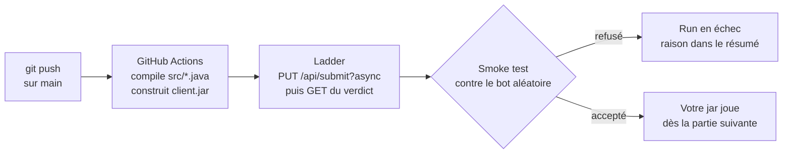

# Soumettre son jar automatiquement

[`ladder.yml`](ladder.yml) est un workflow GitHub Actions pour le dépôt de votre équipe. À chaque push sur `main` qui modifie `src/`, il compile votre client, construit le jar et l'envoie au ladder. Vous n'avez plus rien à faire à la main : votre dernière version joue contre les autres équipes et apparaît au classement.



## Ce qu'il faut

- Le code Java dans `src/`, sans package, avec une classe `Client` qui contient le `main`.
- Le **token** de votre équipe, donné en privé par l'enseignant.
- L'**adresse** de la page du ladder, par exemple `https://ladder.example.org`.

## Installation

1. Copier `ladder.yml` dans le dépôt de l'équipe, sous `.github/workflows/ladder.yml`, puis le committer.
2. Sur GitHub, ouvrir **Settings > Secrets and variables > Actions**.
3. Onglet **Secrets**, bouton **New repository secret** : nom `LADDER_TOKEN`, valeur le token de l'équipe.
4. Onglet **Variables**, bouton **New repository variable** : nom `LADDER_URL`, valeur l'adresse de la page du ladder.

| Nom | Où | Valeur |
| --- | --- | --- |
| `LADDER_TOKEN` | Secrets | token de l'équipe (ne jamais le committer) |
| `LADDER_URL` | Variables | adresse de la page du ladder |

Tant que `LADDER_URL` n'est pas réglée, le workflow est sauté : il peut rester dans le dépôt sans rien casser.

## Soumettre

- **Automatiquement** : pousser sur `main` un commit qui modifie `src/`.
- **À la main** : onglet **Actions**, workflow **Ladder**, bouton **Run workflow**.

Le smoke test joue deux parties et attend la fin de la partie en cours du ladder : un run prend quelques minutes. Le workflow envoie le jar, puis interroge le verdict toutes les 5 s : aucun proxy ne coupe la requête en cours de route. Un `ladder.yml` copié avant cette version attend le verdict sur une seule requête, qu'un proxy comme Cloudflare coupe au bout de 100 s : recopier `ladder.yml`. Le verdict s'affiche dans le **résumé du run** (onglet Actions, cliquer sur le run), avec un lien vers le classement.

## Lire le verdict

| Résumé du run | Sens | Que faire |
| --- | --- | --- |
| `HTTP 200` accepté | Nouvelle version en jeu dès la prochaine partie | Rien |
| `HTTP 200` déjà actif | Ce jar est déjà celui qui joue (même commit relancé) | Rien |
| `HTTP 400` | `Ladder-Threads` du manifeste ne vaut ni 1 ni 2 (jar construit à la main) | Le corriger, ou passer par `MULTITHREAD` dans `ladder.yml` |
| `HTTP 401` | Token absent ou faux | Vérifier le secret `LADDER_TOKEN` |
| `HTTP 413` | Jar trop gros | Retirer les fichiers inutiles de `src/` |
| `HTTP 422` | Refusé par le smoke test : dépassement de temps, déconnexion, absence ou coup invalide. L'ancienne version continue de jouer | Lire la raison, tester en local (voir plus bas), corriger |
| `HTTP 429` | Soumission trop rapprochée de la précédente | Attendre le délai indiqué, puis **Run workflow** |
| `HTTP 500` | Erreur du ladder | Réessayer plus tard |
| `HTTP 503` | Ladder en redémarrage | **Run workflow** dans quelques minutes |
| `HTTP 404` | Verdict perdu : le ladder a redémarré pendant le smoke test | Regarder la version affichée sur la page ; si elle n'a pas changé, **Run workflow** |
| `HTTP 000` | Ladder injoignable | Vérifier `LADDER_URL` ; sinon, soumettre par le formulaire de la page |
| `verdict inconnu` (avertissement, run vert) | Un proxy (Cloudflare) a intercepté l'envoi ou la lecture du verdict : ce n'est pas une réponse du ladder | Si le tag `V<n>` est posé, le jar est accepté. Sinon, chercher le build affiché dans `GET /api/stats/submissions?team=<équipe>`, ou **Run workflow** dans quelques minutes |

Perdre le smoke test n'est pas un refus : seul compte le fait de jouer jusqu'au bout avec des coups valides.

## Retrouver le commit d'une version du classement

Le classement numérote les versions de votre jar **v1, v2, v3…** dans l'ordre où elles apparaissent. Après chaque soumission acceptée, le workflow attend que le ladder affiche la nouvelle version, puis pose le tag **`V<n>`** (même numéro, en majuscule) sur le commit soumis. Pour savoir quel code jouait une partie de `v7` : `git show V7`, ou la liste des tags sur GitHub. Le message du tag garde le build (SHA-256 abrégé du jar) pour recouper avec le ladder.

- Si le même jar est soumis à nouveau (relance, changement sans effet sur le bytecode), il garde son numéro et son tag.
- Une soumission refusée ou annulée par un push plus récent ne crée pas de tag.
- Le tag est posé quand la première partie de la nouvelle version est jouée : l'étape peut attendre jusqu'à 10 minutes (équipes multithread : parties plus rares).
- Le workflow a besoin de `permissions: contents: write` (déjà présent dans `ladder.yml`) et lit `LADDER_URL/data/summary.json`. Si le tag échoue, l'étape est signalée en avertissement mais la soumission reste valide.
- Si le ladder est réinitialisé, ses numéros repartent de v1 : les anciens tags `V<n>` ne correspondent plus. Supprimez-les (`git push origin --delete V1 V2 …`) ou gardez-les comme historique.
- Les tags sont en majuscule exprès : `release.yml` ne cherche que `v[0-9]*` pour calculer la version du projet.

## Obfusquer le jar (optionnel)

Dans `ladder.yml`, remplacer `OBFUSCATE: false` par `OBFUSCATE: true` (en haut du fichier) : le workflow passe vos classes dans [ProGuard](https://github.com/Guardsquare/proguard) avant de construire le jar : classes, méthodes et champs deviennent `a`, `b`, `c`… Seul `Client.main` garde son nom. Le jar se comporte exactement pareil et ne joue pas plus lentement.

C'est une gêne, pas une protection : un décompilateur ou une IA retrouve quand même la logique du code.

Les stack traces du jar affichent alors les noms obfusqués, par exemple dans la raison d'un refus 422. Chaque run garde l'artefact `proguard-mapping` (le fichier `mapping.txt`), qui les retraduit avec l'outil `retrace` de ProGuard :

```sh
java -jar proguard-7.10.0/lib/retrace.jar mapping.txt trace.txt
```

Si votre code charge des classes par leur nom (réflexion, `Class.forName`), le renommage le casse : le smoke test refusera le jar, et l'ancienne version continuera de jouer.

## Bot multithread (optionnel)

Par défaut, votre bot a **1 cœur**. Des threads en plus se le partagent et ne font rien gagner.

Dans `ladder.yml`, remplacer `MULTITHREAD: false` par `MULTITHREAD: true` : le jar déclare `Ladder-Threads: 2` dans son manifeste, et toutes vos parties se jouent sur **plusieurs cœurs par couleur** (4 processeurs vus par la JVM sur le ladder du cours). Votre adversaire a les mêmes cœurs, pour que la partie reste équitable. En échange, ces parties se jouent sur un emplacement réservé, partagé avec les autres équipes multithread : vous jouez **moins souvent**, et votre classement se stabilise plus lentement. N'activez l'option que si votre bot calcule vraiment en parallèle.

Le smoke test, lui, se joue toujours sur 1 cœur. Calibrez donc le nombre de threads sur ce que la JVM voit, plutôt que de le coder en dur :

```java
int threads = Runtime.getRuntime().availableProcessors(); // 1 au smoke test, plus sur les parties multithread
```

La déclaration suit le jar : si la version suivante est construite avec `MULTITHREAD: false`, elle rejoue sur 1 cœur. Sans la CI, ajoutez la ligne `Ladder-Threads: 2` au manifeste vous-même (`jar --create --manifest ...`).

## Jouer sans téléverser son jar (optionnel)

Votre jar peut aussi jouer depuis votre ordinateur : il n'est jamais envoyé au serveur, seuls ses coups le sont. Téléchargez l'archive de votre système depuis la [dernière release](https://github.com/VianAtETS/LOG200-Scoreboard/releases/latest), puis :

```sh
LADDER_TOKEN=<token> ./isolation-remote --url <adresse de la page> -- java -jar Client-eqXX.jar
```

Sous Windows (PowerShell) : `$env:LADDER_TOKEN="<token>"`, puis `.\isolation-remote.exe --url ... -- java -jar Client-eqXX.jar`.

Tant que la commande tourne, votre équipe est au tirage : le relais lance votre jar pour chaque partie, et il se connecte à `localhost:8888` comme d'habitude. Fermez-la (Ctrl+C) pour arrêter ; si vous avez aussi soumis un jar, c'est lui qui reprend.

- **La latence compte dans votre temps par coup.** Le relais annonce à votre jar un temps réduit d'autant dans le message `0` : lisez-le plutôt que de coder 500 ms en dur.
- **Vos parties portent le badge "distant".** Le serveur ne vérifie ni votre code ni votre machine : la page permet de les retirer du classement ("Vérifiées seulement").
- **Une partie commencée se joue.** Couper le relais pendant une partie la fait perdre (`disconnect`), et la suivante de la paire aussi (`no_show`).

## Tester avant de pousser

Un refus 422 se reproduit en local avec l'arbitre et le bot de la [dernière release](https://github.com/VianAtETS/LOG200-Scoreboard/releases/latest) : voir "Test your bot" dans le [README principal](../README.md#test-your-bot).

## Sans la CI

Le formulaire de la page du ladder fait la même chose, tout comme `curl` :

```sh
curl -T client.jar -H "Authorization: Bearer $LADDER_TOKEN" "$LADDER_URL/api/submit?async"
# répond le chemin du verdict, à interroger jusqu'à ce que le code ne soit plus 202 :
curl -i -H "Authorization: Bearer $LADDER_TOKEN" "$LADDER_URL/api/submit/<id>"
```

Sans `?async`, `curl` attend le verdict sur la même requête, ce qu'un proxy peut couper (Cloudflare : 100 s).

Détails du protocole de soumission : "Soumission des jars" dans [`docs/formats.md`](../docs/formats.md#soumission-des-jars).
